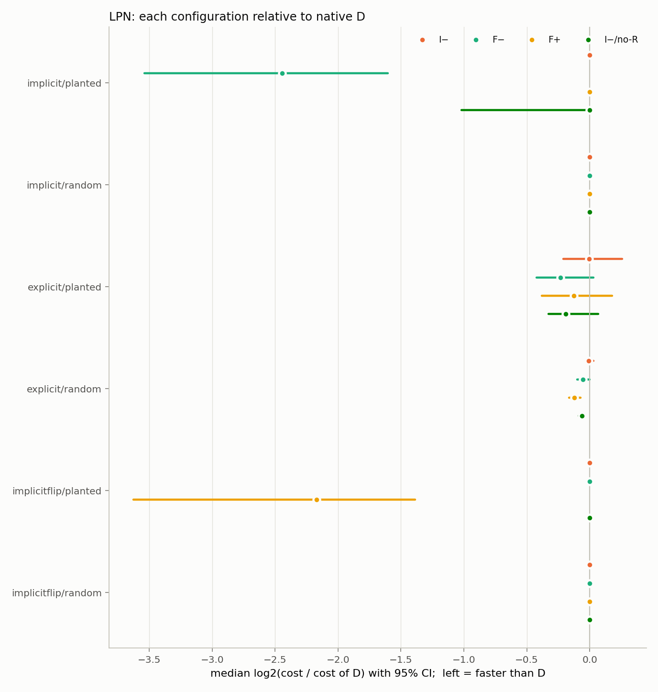

# LPN 稀疏 secret 正式网格 `lpn_sparse_main`：结果报告

状态：完成（2026-10-21）。预注册见 [../../PREREGISTRATION.md](../../PREREGISTRATION.md) 与 [../../README.md](../../README.md) 第 4–5 节；本次运行使用分支 `lpn-sparse-secret` 提交 `3c42b3f` 的代码，没有修改任何实验代码、网格、配置或分析脚本。判定表由 `analyze.py` 生成（[predictions.md](predictions.md)，[predictions.json](predictions.json)，[effects.png](effects.png)）；独立复核和事后分析由新增的 `posthoc.py` 生成（[posthoc.md](posthoc.md)）。

## 1. 运行概况

| 项 | 值 |
|---|---|
| 实例 | 480 个（3 种编码 × τ_e ∈ {1/5, 1/4} × n ∈ {24, 32, 40, 48} × planted/random × seed 10–19），生成的 CNF 与预注册 SHA-256 **480/480 一致** |
| 配置 | D、I−、F−、F+、I−/no-R；`--stats --seed=0 -t 120`；solver 为 `build/upstream/cadical`（3.0.1，sha256 `250220f9…`，与主研究相同） |
| 归约测试 | `test_reduction.py` 768 次求解与穷举全部一致（512 SAT 语义检查、256 UNSAT LRAT），smoke 与正式作业各跑一次 |
| 运行 | 2,400 个 run_id 全部记录，0 缺失；1 次 contended（1.6 s 的短运行，wall/CPU 1.55，出现在启动阶段）按规则重跑一次后有效；最终 0 contended，最大 wall/CPU 1.07；0 次被硬杀 |
| 答案 | 638 SAT、400 UNSAT、1,362 未解出（CaDiCaL 在 CPU ≈ 120 s 时停止）。planted 上 0 个 UNSAT；random 上 0 个 SAT |
| 验证 | 638 个 SAT model 全部在原 CNF 上通过，且全部通过独立 LPN 语义检查；**解出的 (s, e) 全部等于 planted 解**（wt(s) = 3）。400 个 UNSAT（全部来自 explicit/random）全部由 `--lrat` 复跑并通过 lrat-check；复跑的 conflicts/decisions 与计时运行 400/400 相同 |
| 环境 | Slurm `cpu-low` 独占节点 cpu-207-129（AMD，2 socket，192 逻辑 CPU，ThreadsPerCore = 2），gs-srun 容器（镜像 1_26，Python 3.10.12），46 个并发 solver，`QUIET_LOAD` = 54，验证 16 个 worker |

**与预注册文本的偏离**（只涉及执行环境，不涉及设计与分析）：

- 预注册记录写的是作者本机的“8 worker、`--quiet-load 13`”；本次按 README 对集群给出的建议用 46 个 worker（独占 96 核节点），`QUIET_LOAD` 取 run_all.sh 默认值 WORKERS+8。46 个并发进程可能通过共享缓存和内存带宽使 CPU 时间略有膨胀；runner 把 (实例, 配置) 随机打乱，因此这种膨胀在各配置之间大致均匀。
- README 中的 slurm 示例（非 array 的 `sbatch --wrap`）在本集群上不可用（gs-srun 会报 “CPU count per node can not be satisfied”），改用新增的 `slurm_run.sh`（单元素 array 作业），流程仍是 `run_all.sh`。
- 容器内没有 matplotlib，`run_all.sh` 跳过了画图；之后用分析 venv（Python 3.10.20，matplotlib 3.9.2）重跑了 `analyze.py`，`predictions.json` 与 `predictions.md` 与容器内的输出**逐字节相同**，只是新增了 `effects.png`。

## 2. 预注册预测 Q1–Q5

效应 = 逐实例 r_X = log2((c_X + 0.1)/(c_D + 0.1)) 的实例中位数，95% bootstrap CI（10,000 次，seed 20261021）；未解出记 c = 2T = 240 s。

| 预测 | 效应 [95% CI]（×比值） | 判定 |
|---|---|---|
| **Q1** implicit + planted：F− 快于 D | **−2.44 [−3.54, −1.60]（×0.18）** | **supported** |
| 　次要：τ_e = 1/5 | −3.57 [−5.30, −2.44]（×0.08） | |
| 　次要：τ_e = 1/4 | −1.28 [−2.46, 0.00]（×0.41） | （CI 上界恰为 0） |
| **Q2** 配对差 d = r_F−(explicit) − r_F−(implicit) > 0，n = 80 | **+2.23 [+1.17, +3.32]** | **supported** |
| 　explicit + planted：F− vs D | −0.23 [−0.42, +0.03]（×0.85） | |
| **Q3** implicitflip + planted：F+ 快于 D | **−2.17 [−3.62, −1.39]（×0.22）** | supported |
| 　且 F− 慢于 D | +0.00 [+0.00, +0.00] | not supported（删失，见下） |
| 　**Q3 整体** | | **not supported**（按预注册规则两部分须同时成立） |
| **Q4** implicit random | 全部配置 0/80 解出 | **vacuous** |
| **Q4** explicit random（全部 UNSAT 且全部证明） | −0.05 [−0.10, −0.002]（×0.96） | **not supported**（效应确实小于 planted 的 −0.23，但 CI 上界 < 0，即 F− 有一个很小的一致优势） |
| **Q4** implicitflip random | 全部配置 0/80 解出 | **vacuous** |
| Q5（探索性）implicit + planted：F− vs I− | −2.47 [−3.57, −1.74]（×0.18） | — |
| Q5（探索性）implicit + planted：F− vs I−/no-R | −1.42 [−2.44, −0.04]（×0.37） | — |

各格 solved 数（每格 80 个实例）：

| 格 | D | I− | F− | F+ | I−/no-R |
|---|---:|---:|---:|---:|---:|
| implicit / planted | 25 | 22 | **61** | 1 | 38 |
| explicit / planted | 80 | 80 | 80 | 80 | 80 |
| implicitflip / planted | 19 | 16 | **0** | **56** | 0 |
| implicit / random | 0 | 0 | 0 | 0 | 0 |
| explicit / random | 80 | 80 | 80 | 80 | 80 |
| implicitflip / random | 0 | 0 | 0 | 0 | 0 |

按规模（implicit / planted，每个 n 20 个实例）：F− 20 / 19 / 14 / 8，D 14 / 5 / 3 / 3（n = 24 / 32 / 40 / 48）。完整分格表见 [predictions.md](predictions.md)。



## 3. 解读

**Q1（supported）**：当 secret 的稀疏性只体现在解里时，强制负分支有很强的效果。F− 解出 61/80，D 解出 25/80；逐实例看，F− 解出而 D 未解出 36 个，反过来 0 个（事后符号检验 p = 3e−11，见 [posthoc.md](posthoc.md) B1）。中位加速约 5.5 倍；τ_e = 1/5 时约 12 倍；τ_e = 1/4 时约 2.4 倍，但该子组 CI 上界恰为 0。优势一直保持到最大规模 n = 48（8 对 3）。

**Q2（supported，但有天花板效应，需要限定解释）**：把 wt(s) ≤ 3 写进约束后，F− 相对 D 的优势基本消失（×0.85，CI 含 0），配对差 d 显著为正。但 explicit 编码同时让问题对**所有**配置都变得很容易：5 个配置都解出 80/80，solved 运行的中位 CPU 时间约 1 s；explicit/random 的 UNSAT 也全部在 18 s 内证明。因此这个结果与“约束已携带稀疏性，D 能自己用上它”一致，但本实验区分不了它和“基数约束把 s 的搜索空间压到 C(n, ≤3) 个候选、已经没有可加速的余地”这两种解释。

**Q3（整体 not supported；F+ 部分 supported，F− 部分被删失）**：镜像编码下 F+ 解出 56/80，D 19/80，中位约 4.5 倍加速，与 Q1 对称。F− 部分在预注册的中位数判据下无法成立，原因正是预注册时已写明的删失：61/80 个实例上 D 与 F− 都未解出（r = 0），中位数因此为 0。描述性地看，方向与预测完全一致：F− 在 implicitflip/planted 上 0/80，D 解出的 19 个实例 F− 全部超时（事后符号检验 p = 3.8e−6，**非预注册**）。按预注册规则如实记为 not supported。

**极性镜像（事后）**：同一逻辑实例上，implicit/F− 与 implicitflip/F+ 解出数 61 对 56，逐实例中位 log 比值 0 [0, +1.02]。在相对极性下两者近似对称；CaDiCaL 的其余启发式并不完全极性对称，所以只要求近似。强制方向一旦与解相反就是灾难性的：implicit 上 F+ 1/80（这 1 个在 0 次 decision 时就已解出），implicitflip 上 F− 0/80。

**Q4（implicit/implicitflip vacuous；explicit not supported）**：implicit 与 implicitflip 的 random 实例在 120 s 内没有任何配置解出（预注册时已写明会标注 vacuous）。explicit/random 全部为 UNSAT，F− 比 D 快约 4%，CI 上界略小于 0，所以“无一致优势”这一条不成立。这个小效应不是负极性特有的：F+ 约快 8%（51 胜 0 负），I−/no-R 约快 4%，而保留 rephase 的 I− 与 D 无差别（−0.01 [−0.03, +0.03]）。三个更快的配置的共同点是都不做 rephase（F−/F+ 通过 forcephase，I−/no-R 直接关闭）。这与主研究 M5 的事后观察一致：在 UNSAT 上，关闭 rephase、固定方向更有利。此处属于探索性解读。

**Q5（探索性）**：只改初始符号没有用：I− 解出 22，D 解出 25，F− 相对 I− 仍有约 5.5 倍加速。把“持续强制”和“关闭 rephase”分开看：

- 只关 rephase 已经有帮助：I−/no-R 解出 38、I− 解出 22，I−/no-R 独解 19 个、I− 独解 3 个。
- 持续强制在此之上帮助更大：F− 相对 I−/no-R 为 ×0.37 [−2.44, −0.04]；F− 独解 24 个，I−/no-R 独解 1 个。

在 implicitflip 上，I−/no-R 解出 0 个：负初值加上不做 rephase，相当于一直守着错误方向。

## 4. 与主研究和已有证据的关系

- 主研究（`reports/FINAL_REPORT.md`）的结论是：在竞赛实例上，F− 比 D 差（family-disjoint test 上 PAR2 −29%，主要损失在 SAT）。本实验构造了一个反例家族：解在决策变量上高度稀疏，而且这条信息不在约束里。在这里 F− 稳定、大幅胜出；把极性翻转后，F+ 也同样胜出。合起来说明，forcephase 的价值取决于强制方向与解的极性是否一致，以及这一信息能否被 D 通过 propagation 和 phase saving 自行获得。这是机制证据，不是可部署策略：部署时并不知道解的极性。
- 与已有探索性结果方向一致：quick test 中 D 2/16、F− 10/16、I− 2/16（20 s）。τ = 1/8 的 dry run 中 Q1 方向一致但 CI 含 0，Q2 supported（[../PRIOR_RESULTS.md](../PRIOR_RESULTS.md)）。
- LPN 实例只用作机制实验，不参与主研究的任何方法选择，也不构成新的评估集。

## 5. 局限

- 每个实例只有一个 solver seed（seed 0），T = 120 s，单一机器类型。大量格子被删失：implicit/implicitflip 的 random 全部、planted 的相当一部分。中位数效应在删失下偏向 0，因此对“F− 更慢”的方向不敏感（Q3）。
- explicit 格有天花板效应（见 Q2）。
- 46 个进程共用一个节点；计时有效性只按 wall/CPU 判定，不能排除缓存和内存带宽带来的均匀性膨胀。
- 事后分析（[posthoc.md](posthoc.md) 第 B 部分、本报告中标注“事后”“探索性”的内容）不改变 Q1–Q5 的判定。

## 6. 算力

| 项 | CPU 时间 |
|---|---|
| 计时运行（2,401 次，含 1 次 contended 重跑） | 47.68 核时（planted 20.5，random 27.1） |
| UNSAT 认证复跑（400 次，`--lrat`） | 0.50 核时 |
| lrat-check | 0.05 小时（wall） |
| smoke（120 次运行 + 120 个校验）与两次归约测试 | < 0.1 核时 |
| **合计** | **约 48.3 核时**；预注册最坏 80 核时 |

节点占用：smoke 作业 737179 约 1 分钟，正式作业 737181 约 68 分钟（19:42–20:50 UTC），均为独占 192 逻辑 CPU 节点。

## 7. 复现

```bash
export LPN_WORK=/mnt/data/zhaofeng/projects/workspace/online-tuning-forcephase/lpn_sparse_secret
GRID=smoke T=10 WORKERS=8 experiments/lpn_sparse_secret/slurm_run.sh cpu-low 01:00:00    # 作业 737179
WORKERS=46 VERIFY_WORKERS=16 experiments/lpn_sparse_secret/slurm_run.sh cpu-low 24:00:00 # 作业 737181
# 画图（容器内无 matplotlib）与独立复核 / 事后分析；manifest 是相对本目录的路径
cd experiments/lpn_sparse_secret
$FP_PY analyze.py --exp lpn_sparse_main --manifest benchmarks/lpn_sparse_main.csv
python3 posthoc.py --exp lpn_sparse_main --manifest benchmarks/lpn_sparse_main.csv
```

`$FP_PY` = `/mnt/data/zhaofeng/venvs/online-tuning-forcephase/bin/python`（任何带 matplotlib 的 Python ≥ 3.10 均可）。原始日志、CNF 和作业日志都在 `$LPN_WORK` 下（`runs/`、`cnf-plain/`、`lpn/`、`logs/`）。
