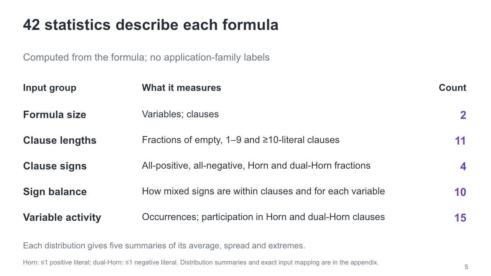
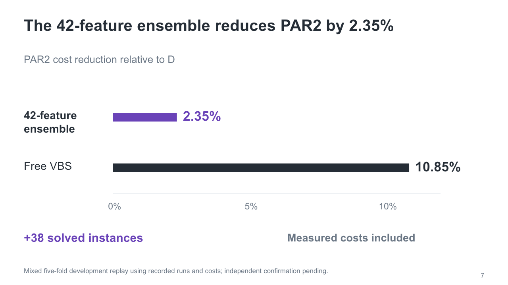

# Force-phase results, November 11, 2026

- [Editable PowerPoint](forcephase-results.pptx): **7 main slides and 8 appendix slides**, with Chinese presentation logic and English speaker notes.
- [Design review](design-review.html): before/after decisions and the necessity, wording and placement of every element.
- [Current cost-weighted classifier result](results/classifier-R54-summary.json), [exact 42-input catalog](results/42-feature-catalog.json), and [baseline/historical results](results/evidence.json).
- [Deck source](sources/): requires `@oai/artifact-tool`; run `node sources/build.mjs`. This rebuilds the slides from frozen data without fitting models or running a solver.

## Main presentation

1. CPU-time cumulative baseline: D, F+, F− and free VBS
2. Cumulative conflicts baseline
3. Paired time scatter plots and concrete wins/losses
4. Structural clustering result
5. What the 42 input statistics measure
6. How cost-weighted tree ensembles select a phase
7. **2.35% PAR2 reduction**, alongside the **10.85% free VBS ceiling**

The main sequence ends at slide 7. Historical regression transfer, Astra interpretation and small-rule compression are in the appendix and explicitly identified as earlier-model evidence. They are not results for the new classifier. Appendix slide 15 expands the exact forty-two coordinates; the separate sixty-three joint bins are not inputs to the current leading model.

## Current leading candidate

The model uses **42 existing CNF statistics**, grouped as:

| Input group | Dimensions |
| --- | ---: |
| Variables and clauses | 2 |
| Clause-length fractions: empty, 1–9, ≥10 | 11 |
| All-positive, all-negative, Horn and dual-Horn fractions | 4 |
| Clause and variable sign-balance distributions | 10 |
| Variable occurrences, Horn participation and dual-Horn participation | 15 |
| Total | **42** |

Each distribution contributes five summaries. Some inputs use frozen log or mean-normalized transforms. The [catalog](results/42-feature-catalog.json) lists each coordinate. No application-family labels, instance identifiers or SAT/UNSAT answers are prediction inputs.

The current model is a **cost-weighted ExtraTrees classifier ensemble**, not the earlier cost-difference regressor. It averages three model scores. For each forced phase, the score is its classifier output minus the D output; scores are preference scores, not predicted seconds saved or calibrated winner probabilities. The selector takes the stronger forced phase only above an inner-validation threshold, otherwise D.

| Cost replay on 4,719 instances | Mean PAR2 (CPU s) | Solved | Saving vs D |
| --- | ---: | ---: | ---: |
| Always D | 392.542654 | 3,385 | 0% |
| Earlier 42-input regressor, full recorded fees | 384.711070 | 3,418 | 1.9951% |
| **42-input cost-weighted classifier, mean3** | **383.317954** | **3,423** | **2.3500%** |
| Free VBS | 349.940732 | 3,547 | 10.8528% |

The classifier rescues 66 instances and loses 28 relative to D, for **38 net additional solves**. Recorded acquisition and prediction costs are composed for all 4,719 inputs, including 25 paid acquisition failures that fall back to D. Reused logical acquisition CPU is 2,027.491559 seconds and query CPU is 83.279956 seconds.

**Scope:** these are repeatedly used mixed five-fold development results. Mean3 was selected after its earlier result was exposed. Its nominal interval is descriptive and not adjusted for model selection. The replay composes measured fees and existing solver outcomes across hosts; independent confirmation and an actual same-host end-to-end classifier/solver run remain pending. Older appendix regression results with 2.10% use a query-only cost scope and must not be confused with the fully composed 1.9951% or new classifier.

## Baseline and paired comparisons

CaDiCaL 3.0.1, solver seed 0, 600 solver CPU seconds per configuration. From 5,355 Anniversary 2022 entries, 636 official all-track-unsolved entries were excluded, retaining 4,719 instances and 14,157 configuration records. D solves 3,385; F+ 3,076; F− 3,055; free VBS 3,547.

VBS chooses the cheapest phase per instance for free. Time and conflicts VBS minimize their respective metrics separately. Conflicts curves use verified completions observed within the same CPU budget, not a new fixed-conflict-budget experiment.

| Pair | Both solved | Only D | Only forced | Neither |
| --- | ---: | ---: | ---: | ---: |
| D / F+ | 2,984 | 401 | 92 | 1,242 |
| D / F− | 2,943 | 442 | 112 | 1,222 |

[Four highlighted instance IDs and exact measurements](results/paired-instance-examples.csv) link the plots to the source matrix. They are descriptive extremes among both-solved pairs, not average gains. A categorical TO rail denotes timeouts rather than assigning an exact solve time. Double timeouts remain counted. [Paired evidence](results/paired-comparisons.json) retains the underlying rows. The appendix conflicts scatter uses only both-solved pairs and keeps zeros through log(1 + count) spacing.

The original 8-cluster experiment uses 12 features; D has the lowest mean PAR2 in every original cluster. Expanded clustering dimensions are 2 / 11 / 7 / 8 / 28 at 12 / 24 / 48 clusters. Its selected 0.16% point improvement remains uncertain. Cluster count and feature dimension are different quantities.

## Previews

## Provenance and editing

The baseline and earlier model summaries come from the supplied post-evaluation snapshot. The complete, untruncated R54 summary was retrieved from the recorded experiment-chat command output; the original raw per-instance R54 prediction files were not independently downloaded or rescored locally. Its reported arithmetic, sample counts and score scope were checked. The exact 42-input mapping and classifier-score definition were independently checked against the supplied frozen source. No new solver calls or fits were performed for this presentation.

Text and plots are editable native PowerPoint objects. Data plots use editable vector paths, rather than embedded Excel workbooks. The deck was rendered and package/import checked without claiming native PowerPoint execution. This release excludes credentials, machine paths, account metadata, original reference decks, model weights, CNFs and temporary files.
