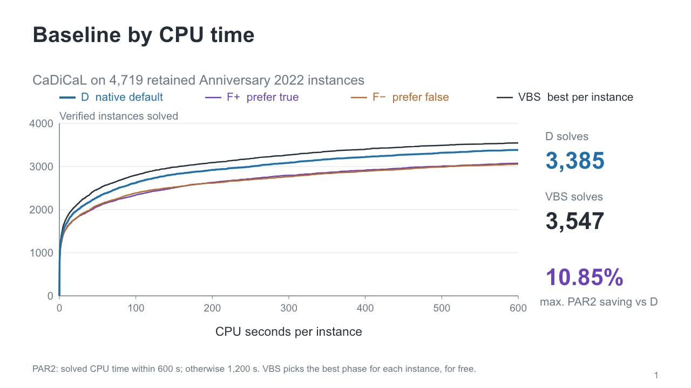
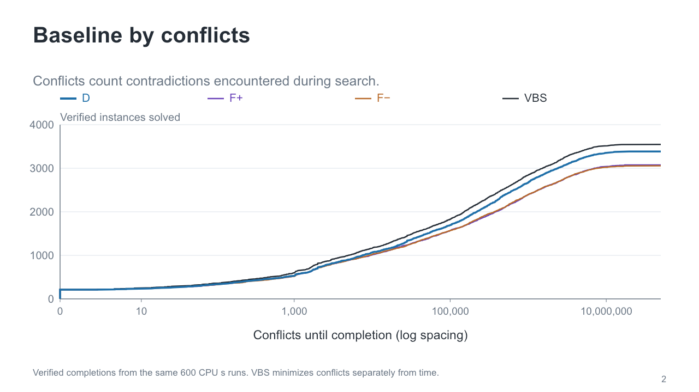
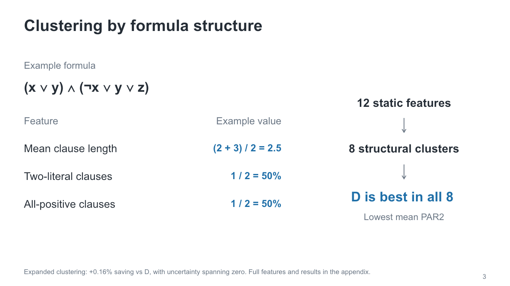
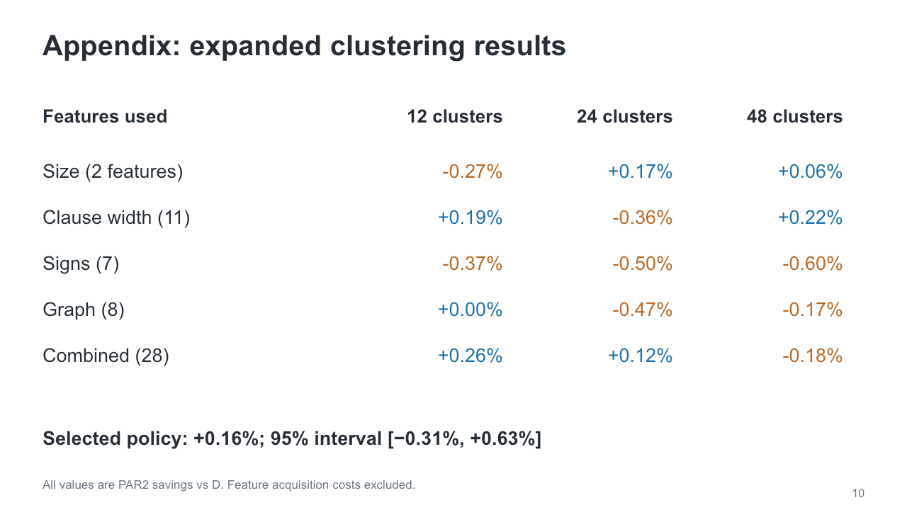

# Force-phase results, November 11, 2026

- [Editable PowerPoint](forcephase-results.pptx): 8 main slides and 3 appendix slides, with Chinese presentation logic and English speaker notes.
- [Design review](design-review.html): download and open locally for before/after previews and every information-element decision.
- [Frozen scientific results](results/evidence.json) and [clustering feature definitions](results/clustering-features.json).
- [Editable deck source](sources/): requires an environment providing `@oai/artifact-tool`; run `node sources/build.mjs`. No solver execution or refitting is required to rebuild the slides.

## Scope and findings

CaDiCaL 3.0.1, solver seed 0, 600 solver CPU seconds per configuration. The retained Anniversary 2022 population has 4,719 instances after excluding 636 official all-track-unsolved entries from the original 5,355. There are 14,157 configuration records.

| Configuration | Verified solves | Mean PAR2 (CPU s) |
| --- | ---: | ---: |
| D | 3,385 | 392.542654 |
| F+ | 3,076 | 468.236516 |
| F− | 3,055 | 471.976052 |
| Free VBS | 3,547 | 349.940732 |

VBS selects the cheapest configuration per instance for free, leaving 10.85% PAR2 headroom over D. Time and conflicts VBS minimize their respective metrics separately. The conflicts curve uses verified completions observed in the same 600-second runs; it is not a new fixed-conflict-budget experiment.

The original 8-cluster experiment uses **12 features**, and D has the lowest mean PAR2 in every cluster. Expanded clustering uses feature-set dimensions **2 / 11 / 7 / 8 / 28** (size / clause width / signs / graph / combined), each evaluated at **12 / 24 / 48 clusters**. Cluster count is independent of input dimension. The selected expanded policy gives an uncertain 0.16% point saving.

The ExtraTrees ensemble shows **2.0977%** PAR2 improvement and 3,419 solves in mixed five-fold development evaluation. Recorded query costs are included, but full feature acquisition costs remain incomplete. A partial replay pricing 1,024 inputs gives about **1.9603%**, with 3,695 input costs still unknown. Structural holdout gains fall to +0.3709% / −0.2608%. These are repeatedly used development results, not independent final-test or complete deployment-speedup claims.

Readable-rule screens give about **0.1717%** (two-condition template), **0.4931%** (small tree), and **0.4401%** (directional rules), assuming free features/queries. They have not retained the ensemble's ~2% gain.

## Reading the deck

1. CPU-time cumulative baseline
2. Conflicts cumulative baseline
3. Actual clustering-feature example and original 8-cluster outcome
4. Supervised prediction and switch-to-F gate
5. Measured gain versus free VBS
6. Structural transfer limits
7. Astra model inspection and readable-rule proposal
8. Rule-compression results
9–11. Population/costs, expanded clustering, original 12-feature definitions

The clustering example `(x ∨ y) ∧ (¬x ∨ y ∨ z)` has mean clause length 2.5, binary fraction 50%, and all-positive-clause fraction 50%. It is an illustration, not a benchmark preference measurement.

## Previews

## Provenance and editing

The baseline is reconstructed from the supplied per-instance snapshot. The ensemble/readable-model scores come from the accompanying supplied summaries and research state; no new fits or solver runs were performed for the slides. Frozen plotted series and geometry are included. Text, curves, and diagrams are editable native PowerPoint objects; curves are vector paths rather than workbook-backed Excel charts. The deck was rendered and package/import checked, without claiming validation in native PowerPoint.

This release excludes credentials, machine paths, original reference decks, model weights, CNFs, proofs, temporary workspaces, and account/deployment metadata. `MANIFEST.json` records checksums for the release files.
