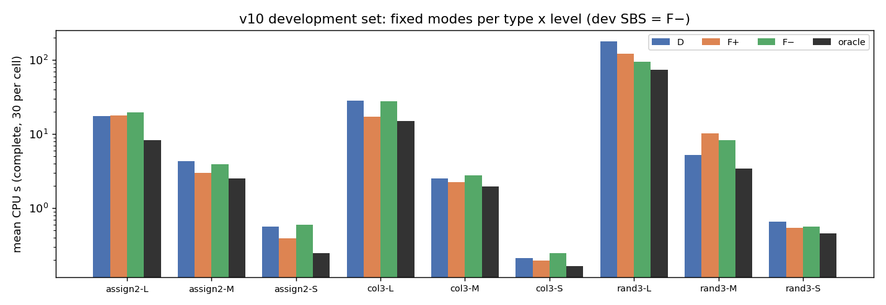
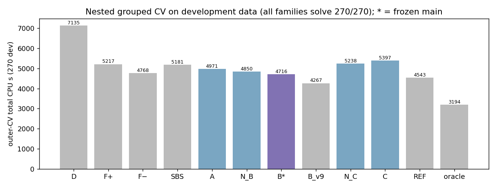
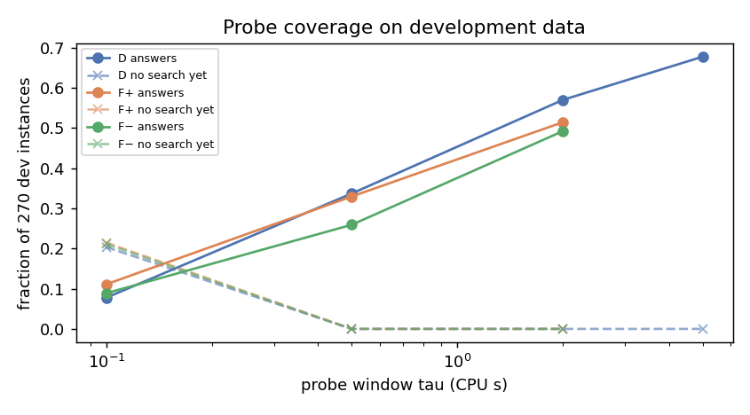
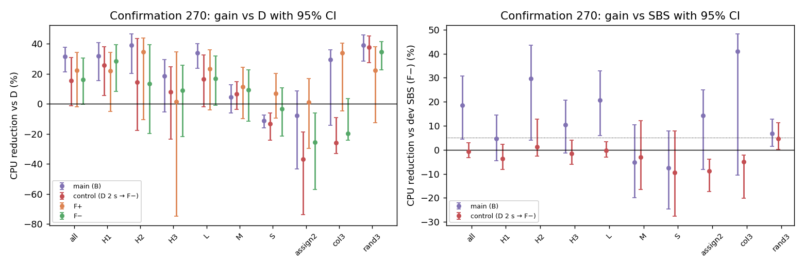
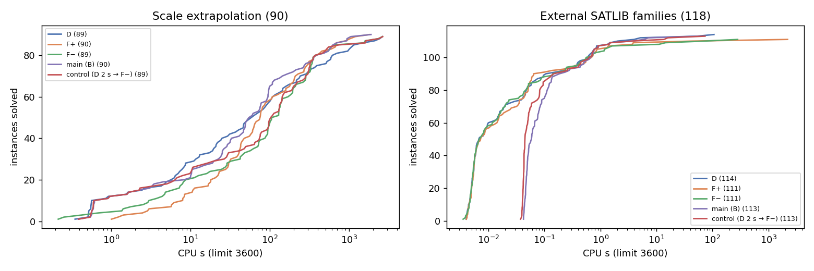
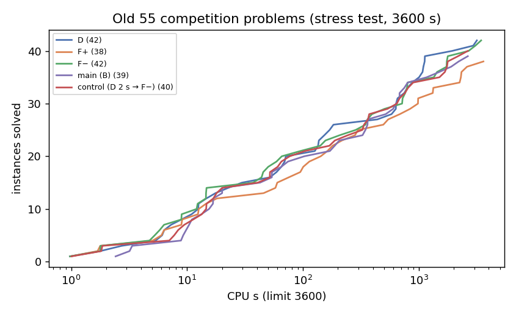

# Goal v10 最终报告：跨规模的低成本 D / F+ / F− 三选一

日期：2026-10-26（UTC）。分支 `research/forcephase-study`。

- **执行目标**：[Agent Goal v10](../../docs/AGENT_GOAL.md)。
- **协议**：[CROSS_SCALE_PROTOCOL_V10.md](../../docs/CROSS_SCALE_PROTOCOL_V10.md)，在任何 v10 求解之前提交（`be6eb7a`）；第 12 节记录全部补充与偏离。
- **冻结**：面板 `v10-panel-freeze`（`666a274`）；规则 `v10-rule-freeze`（`9bf1c58`）。确认、外推、外部运行都在规则冻结之后。
- **分报告**：

  | 报告 | 内容 |
  |---|---|
  | [PRIOR_AUDIT.md](PRIOR_AUDIT.md) | 旧实验审计 |
  | [PILOT.md](PILOT.md) | 试采样 |
  | [BASELINES.md](BASELINES.md) | S2 基线 |
  | [OBSERVATIONS.md](OBSERVATIONS.md) | S3 观察 |
  | [SELECTION.md](SELECTION.md) | S4 冻结 |
  | [VALIDATION.md](VALIDATION.md) | S5 验证 |
  | [COMPUTE.md](../../results/cross_scale_v10/COMPUTE.md) | 算力账本 |

## 摘要

本轮问的是：能否通过廉价的 CNF 分析或短试跑，在 D、F+、F− 中选一次，提前识别“强制方向会显著变差”的实例，并在没有参与开发的规模上稳定地超过最好的固定模式？

**设计**：

- **面板**：三类生成题（随机 3-SAT、图三着色、耦合分配），每类三个开发档（亚秒到分钟级）和一个更大的外推档；新开发 270、新确认 270（H1 / H2 / H3）、外推 90，另有 SATLIB 公开家族 118 题。
- **观察族**（登记了三个，各配同成本无内容对照）：

  | 观察族 | 内容 | 同成本无内容对照 |
  |---|---|---|
  | A | 静态分析 | SBS |
  | B | 静态 + 默认 D 前缀 | N_B |
  | C | 静态 + D / F+ / F− 三臂配对前缀 | N_C |

- **选择与部署**：所有选择都在开发集嵌套分组交叉验证中完成；冻结后用真实 wrapper 部署，单次 3600 CPU s 上限，所有观察费用计入。

**主要结论**：

1. **三模式配对试跑没有用。**
   - 在开发集上，C 比单个 D 前缀的 B 多花 14.4% [4.1, 28.7]；
   - 它的无内容版本 N_C 也比 N_B 差 8.0% [2.6, 16.5]；
   - 臂间进展差与最终成本比的相关 \|ρ\| ≤ 0.25，“谁冲突多就选谁”比任何固定模式都差。

   多试几种模式只是多付观察费。这与 v5 在比赛题上的负结果一致，现在在 F± 有大而稳定优势的生成题上也成立。
2. **冻结的主策略是 B**：静态分析 + D 2 s 预求解，未解则用岭回归在基线 F− 与偏离之间选一次。它是按预注册规则以 1% 的余量选出的。在开发集上，它相对同成本无内容对照“D 2 s → F−”只有 +2.8% [−20.7, +18.4]，并不可靠。
3. **同范围确认集（270 题，全部完成）上，主策略达到了预注册的两条成功标准**：

   | 比较 | 均值（s） | 减少 | 95% 区间 |
   |---|---|---:|---|
   | 对开发 SBS（F−） | 19.65 对 24.11 | 18.5% | [4.4, 30.9] |
   | 对同成本无内容对照 | 19.65 对 24.25 | 19.0% | [4.8, 31.4] |

   但这个正结果很脆弱，必须和以下事实一起读：
   - **高度集中**：一道着色 UNSAT 题贡献了 1204 s 净收益中的 761 s。去掉它，收益降到 +8.8%；去掉前 3 题，降到 +6.4%。
   - **分块不一致**：H1 +4.7% [−4.6, +14.6]，H2 +29.6% [+4.0, +43.7]，H3 +10.5% [−1.2, +20.7]。
   - **只在大题上有效**：收益全部来自 L 档；S、M 档上反而比 SBS 慢 5–8%，因为约 1.3 s 的观察开销比题本身还贵。
   - **相对事后最好的固定模式不可靠**：确认集上最好的固定模式是 F+，不是开发 SBS F−；主策略相对 F+ 为 +12.0% [−0.4, +27.0]。
   - **本质上是按类型路由**：着色题几乎都选 F+，随机题都选 F−，分配题混合。这是 CNF 结构可算出的类型信息，在线可用，但不是对单题胜负的细粒度识别。
4. **规模外推（90 题）**：
   - 主策略与 F+ 都在 3600 s 内解出 90 / 90；D、F−（SBS）与对照都有 1 题超时，所以它们的完整均值为 null。
   - 主策略相对 F+ 为 +10.7% [−3.3, +25.0]，不可靠。
   - 按类型：rand3 上优于所有固定模式（相对 F− +15.0% [+1.3, +33.5]）；更大的分配题上全部选 D，避开了 F+ / F− 相对 D 的 −21% / −81% 退化，相对 D 为 −6.8% [−19.6, +0.9]；着色题上与 F+ 持平（−2.5%）。
   - rand3 的外推档只比开发 L 档大 10 个变量，是弱外推。
5. **未知家族（SATLIB 118 题）**：
   - 默认 D 最好（114 解）；主策略与对照都是 113，F± 都是 111。
   - 主策略几乎完全靠“D 先跑 2 s”直接解出（109 / 118），读出器只用了 9 次。没有证据表明读出器在未知家族上有用。
6. **原 55 道比赛题（可选压力测试，3600 s）**：D 42、F− 42、F+ 38、主策略 39、对照 40。生成题上学到的规则在比赛题上不适用，大多回退到 F−，少解的题比 D 多。
7. **能否提前识别“强制会显著变差”的题**：
   - **类型层面可以**：大分配题 → D；随机 SAT 题 D 在 2 s 内就会解出，D 预求解实际上就是 SAT 过滤器。
   - **单题层面不行**：只改变量编号，54 题中就有 30 题的最快模式改变；前缀统计与最终成本比只有弱相关。

**一句话**：在同一生成分布的确认集上，“D 2 s 预求解 + 按 CNF 结构路由”确实比开发 SBS 和同成本无内容对照都快 18–19%，区间都大于 0；但收益集中、主要来自类型路由，没有稳定胜过事后最好的固定模式，也没有在未知家族或比赛题上带来收益。三模式配对试跑是清楚的负结果。

## Summary (English)

**Question.** Can a cheap observation choose once among CaDiCaL's default phase saving (D), forced positive (F+) and forced negative (F−)? Specifically, can it spot in advance the instances where forcing is much worse, and beat the best fixed mode on scales not used for development?

**Panels.**

- Three generated types: random 3-SAT, graph 3-colouring and coupled assignment.
- Three development levels per type (sub-second to about a minute of default CPU) plus one larger extrapolation level, all from a rule-based pilot.
- Panel sizes: fresh dev 270, confirmation 270 (blocks H1/H2/H3) and extrapolation 90.
- External set: 118 public SATLIB instances from 16 families.

**Method.**

- Three registered observation families, each with a matched content-free control:
  - A, static analysis;
  - B, static analysis plus a default D prefix;
  - C, static analysis plus paired D / F+ / F− prefixes.
- Two readers: ridge cost-difference and shallow trees, each with a conservative deviation margin from the development SBS.
- Nested grouped CV on dev, then freeze.
- Real wrapper deployment with every observation CPU-second charged, under a 3600 CPU-second per-run limit (whole process tree).

**Findings.**

- **Paired three-mode probing does not pay.**
  - On dev, C costs 14.4% more than the single-prefix family B; its content-free version N_C costs 8% more than N_B.
  - Arm-difference statistics correlate only weakly with the final cost ratio (|ρ| ≤ 0.25).
  - Picking the arm with the most conflicts is worse than any fixed mode.
- **The frozen main strategy is B**: static analysis plus a 2 s D pre-solve, then a ridge choice between base F− and a deviation.
- **Confirmation (270 instances, all methods complete).** The main strategy averages 19.65 s, against 24.11 s for the dev SBS (F−) and 24.25 s for the matched control (D 2 s → F−):

  | Comparison | CPU reduction | 95% CI |
  |---|---:|---|
  | vs dev SBS | 18.5% | [4.4, 30.9] |
  | vs matched content-free control | 19.0% | [4.8, 31.4] |

  Both pre-registered same-range criteria are met, but the gain is fragile:
  - one colouring UNSAT instance supplies 761 of the 1204 s net gain (+8.8% without it);
  - it comes entirely from the large level;
  - it is block-inconsistent (H1 +4.7%, interval includes 0);
  - it is not reliable against the best fixed mode in hindsight, F+ (+12.0% [−0.4, +27.0]);
  - it amounts to type routing: colouring → F+, random → F−, assignment mixed.
- **Extrapolation (90).**
  - Main and F+ solve 90/90; D, the SBS and the control solve 89/90, so their complete means are null.
  - Main vs F+: +10.7% [−3.3, +25.0].
  - The main strategy routes large assignment instances to D, avoiding the −21% / −81% degradation of F+ / F−. It wins on random 3-SAT (+15% vs F−) and ties F+ on colouring.
- **Old 55 competition problems (optional stress test, 3600 s).**
  - Solved: D 42, F− 42, F+ 38, main 39, control 40. The F± records that previously had only 300 s bounds are now complete.
  - The 2 s D probe usually has not started search on these large formulas, so the main strategy mostly falls back to F− and loses 5 instances to D (gains 2).
- **External families (118).**
  - D is best (114 solved); main and control 113; F+ and F− 111.
  - The 2 s D pre-solve answers 109 instances by itself; there is no evidence that the reader helps on unknown families.
- **Per-instance winners are not stable.** Renaming variables changes the fastest mode on 30 of 54 instances. Fine-grained identification of where forcing hurts is not supported; type-level identification is.

**Verdict.** A bounded positive on the same generated distribution, driven by D pre-solving and structural type routing rather than instance-level prediction. There is no reliable gain over the best fixed mode across scales and none on unknown families or competition problems. Paired three-mode probing is a clear negative.

## 1. 设计（与 v9 的差别）

| 项目 | v9 | v10 |
|---|---|---|
| 开发档 | rand3 n 260 / 300 / 350，col3 400 / 500 / 550，assign2 T 300 / 350 / 450 | rand3 220 / 290 / 340，col3 350 / 450 / 550，assign2 250 / 350 / 450（更宽：亚秒到分钟级） |
| 外推 | 两档，部分超时 | 每类一个开发范围之外的档：rand3 350（弱）、col3 625、assign2 550，按 3600 s 覆盖规则选 |
| 观察 | D 前缀，读最后一个 checkpoint | 静态 20 指标；D 前缀与三臂前缀都读停止时统计与进度行；同成本无内容对照 |
| 基线 | 偏离 D | 保守地偏离开发 SBS |
| 截止 | 无（后补 3600 s 视图） | 3600 s 整棵进程树，内核与控制器双重执行 |
| 外部 | SATLIB 60（多为亚秒） | SATLIB 118，16 个家族，避开 v9 用过的文件 |

## 2. 结果

### 2.1 开发集（[BASELINES.md](BASELINES.md)、[SELECTION.md](SELECTION.md)）



- **固定模式**（均值）：D 26.4 s，F+ 19.3 s，F− 17.7 s（开发 SBS），oracle 11.8 s。
- **按答案分开**：rand3 L 档 13 道 SAT 全是 D 最快，17 道 UNSAT 全是 F± 最快。
- **稳定性**：seed 1 下最快模式 49 / 54 相同；变量重排下只有 24 / 54 相同。聚合顺序 F− < F+ < D 与 9 次“F+ 显著变差”在两种扰动下都保持。



**外层总 CPU**（270 题全部解出）：

| 族 | 外层总量（s） |
|---|---:|
| SBS | 5181 |
| A | 4971 |
| N_B | 4850 |
| **B（主策略）** | **4716** |
| N_C | 5238 |
| C | 5397 |
| B_v9（旧基线，未作候选） | 4267 |
| REF（D 2 s → F+） | 4543 |

- 所有带 probe 的族，收益都来自 D 2 s 直接解出（开发集 154 / 270），之后的选择相对 SBS 都是净损失。
- 留一规模档诊断中，读出器都没有胜过无内容的 N_B。



### 2.2 同范围确认（[VALIDATION.md](VALIDATION.md) 第 1 节）



| 方法 | 均值（s） | 相对 D | 相对开发 SBS |
|---|---:|---|---|
| D | 28.73 | — | |
| F+ | 22.33 | +22.3% [−2.1, +34.3] | |
| F−（SBS） | 24.11 | +16.1% [−0.4, +30.4] | — |
| **主策略** | **19.65** | +31.6% [+21.3, +37.7] | **+18.5% [+4.4, +30.9]** |
| 对照 | 24.25 | +15.6% [−1.4, +30.7] | −0.6% [−3.3, +2.9] |

### 2.3 外推与外部家族（[VALIDATION.md](VALIDATION.md) 第 3–4 节）



### 2.4 原 55 题压力测试（可选，[VALIDATION.md](VALIDATION.md) 第 5 节）



3600 s 内已解数（共 55 题）：

| 方法 | 已解 |
|---|---:|
| D | 42 |
| F+ | 38 |
| F− | 42 |
| 主策略 | 39 |
| 对照 | 40 |

- 至少一个固定模式能解出的有 46 题。
- F± 的 3600 s 记录现在已补齐，不再有“不可重建”的题。
- 主策略相对 D 多解 2 题、少解 5 题。大公式上 D 2 s probe 多半还没进入搜索（35 / 55），于是回退 F−；读出器 2 次选 D 造成严重误选（F− 50 s、D 超时）。
- 生成题上学到的规则在比赛题上不适用。

## 3. 结论分类

| 类别 | 内容 |
|---|---|
| **实测（冻结后真实部署）** | 确认 270 题：主策略相对开发 SBS +18.5% [+4.4, +30.9]，相对同成本无内容对照 +19.0% [+4.8, +31.4]，相对 D +31.6%；收益集中，去掉最大一题后 +8.8%；S / M 档为负。外推 90 题：主策略与 F+ 都是 90 / 90，相对 F+ +10.7% [−3.3, +25.0]。外部 118 题：D 114，主策略 113。原 55 题：D 42，主策略 39；原 55 题的 3600 s 视图已补齐（F+ 38，F− 42）。 |
| **离线模型（开发集嵌套验证）** | 三模式 C 与 N_C 都不如单个 D 前缀；内容相对同成本对照的增量在开发集上都不显著；收益主要来自 D 预求解直接解出。模拟与真实部署的决策一致 262 / 270，总成本差 3.9%。 |
| **相关与机制假说（未经干预验证）** | (a) 读出器学到的是类型：着色 → F+，随机 → F−，大分配 → D。(b) 随机题上 D 2 s 预求解近似 SAT 过滤器。(c) 单题“哪个模式最快”在变量重排下一半以上会改变，所以短前缀统计难以识别单题胜负；类型层面的倾向是稳定的。 |
| **未知** | 读出器在未知家族上的作用：外部集大多是亚秒题，只有 9 题走到读出器，证据不足。更远的规模外推（rand3 n ≥ 360 在 3600 s 下已开始超时）。主策略相对“简单按类型路由的固定规则”是否还有增量：本轮没有登记这样的对照，只能事后推测。 |

## 4. 局限

- **确认集上的正结果由少数大题决定**，分块不一致，不应外推为“读出内容普遍有用”。一个新的独立确认集（下一轮）才能检验它是否稳定。按协议，本轮不回头调整。
- **rand3 外推是弱外推**（+10 个变量）。这是 3600 s 覆盖规则的结果：n = 360 的 UNSAT 题 D 已超过 1400 s。
- **外部集难度偏低**：D 1 s 内解出 107 / 118。最难的 4 题所有方法都超时。
- **平台**：
  - `robust_dev` 被 Slurm 抢占，丢失 2 个运行，已补跑；
  - 外部阶段与外推阶段同节点，外部运行的墙钟 / CPU 中位为 1.28（分时），指标是 CPU 时间；
  - 8 个运行被内核 CPU 上限在 3600 s 处停止，原记为 `error`，已按更正后的规则计为超时（协议第 12 节，`status_corrections.json`）。
- **计时噪声**：同一命令重复运行的 CPU 比值 5% / 95% 分位为 0.88 / 1.23，大分配题上单次可达 1.46 倍。小于这个量级的单题差异不应解读。

## 5. 复现

**最小复现**（2026-10-26 在 gs-srun 容器中实际执行过，输出保存在 `$FP_DATA/cross_scale_v10/repro/output.txt`）：

```bash
cd /mnt/home/zhaofeng/workspace/online-tuning-forcephase && source /mnt/data/shared/config/env.sh && GENESIS_IMAGE_VER=1_26 gs-srun --partition=cpu-mid --nodes=1 --ntasks=1 --cpus-per-task=4 --time=00:20:00 bash -c 'cd /mnt/home/zhaofeng/workspace/online-tuning-forcephase && scripts/cross_scale_v10/repro.sh v10-col3-L-53'
```

输出原文：

```
exit 20 tree_cpu 71.85 path reader action Fp static ok 0.0046 probes [('D', 2.0, -15, 2.015)] cpu_at_exec 2.055
answer UNSAT verified True checker lrat-trim checker_cpu 3.13
```

- 静态分析 0.005 s；D probe 2.015 s 后未解（SIGTERM）；读出器选 F+，从头运行。
- 整棵进程树 71.85 s，确认阶段同一题的记录为 69.7 s；UNSAT 经 lrat-trim 验证。

**完整流水线**（与实际执行的命令相同）：

```bash
# 试采样与面板
python3 scripts/cross_scale_v10/plans.py pilot-gen   # 生成在容器中: gen.py generate --plan configs/cross_scale_v10/pilot_gen.json ...
python3 scripts/cross_scale_v10/plans.py pilot-plan
scripts/cross_scale_v10/slurm_run.sh pilot configs/cross_scale_v10/plans/pilot.json "" 1-00:00:00
python3 scripts/cross_scale_v10/plans.py pilot-decide
scripts/cross_scale_v10/make_panels.sh                # 容器内：正式生成、查重、划分、重排变体、外部选择
# 开发运行
for s in s1_dev measure_dev robust_dev; do scripts/cross_scale_v10/slurm_run.sh $s configs/cross_scale_v10/plans/$s.json "" 2-00:00:00; done
# 分析与冻结（分析 venv）
FP_PY=/mnt/data/zhaofeng/venvs/online-tuning-forcephase/bin/python
$FP_PY scripts/cross_scale_v10/baselines.py
$FP_PY scripts/cross_scale_v10/selection.py cv && $FP_PY scripts/cross_scale_v10/selection.py freeze
$FP_PY scripts/cross_scale_v10/observations.py
python3 scripts/cross_scale_v10/plans.py deploy-plans
# 验证（cpu-mid）
for s in confirm extrap external deploy_dev; do V10_PARTITION=cpu-mid scripts/cross_scale_v10/slurm_run.sh $s configs/cross_scale_v10/plans/$s.json "" 3-00:00:00; done
for p in confirm extrapolation external dev_deploy; do $FP_PY scripts/cross_scale_v10/validation.py --panel $p; done
$FP_PY scripts/cross_scale_v10/simcheck.py
python3 scripts/cross_scale_v10/status_corrections.py && python3 scripts/cross_scale_v10/stress.py
$FP_PY scripts/cross_scale_v10/figures.py && python3 scripts/cross_scale_v10/ledger.py
```

## 6. 算力

v10 合计 136.7 核时（[COMPUTE.md](../../results/cross_scale_v10/COMPUTE.md)），只记账，不设额度：

- 求解与 wrapper：135.5 核时；
- 检查器：0.97 核时；
- 抢占损失：0.2 核时。

主要部分：

| 阶段 | 核时 |
|---|---:|
| 原 55 题压力测试 | 58.5 |
| 外部 | 28.8 |
| 外推 | 28.0 |
| 确认 | 8.9 |
| 开发运行 | 4.8 + 0.6 + 1.9 |
