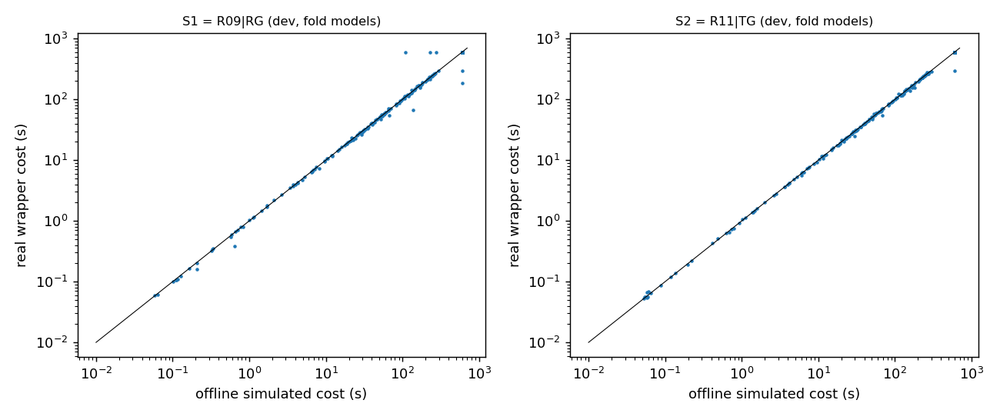

# 部署表（由 `scripts/observations_v5/v5deploy.py` 生成）

## 1. dev 401 真实运行（每题用其家族被留出那一折的模型）

| 策略 | 完成 | 解出 | 真实 PAR2 | 真实净收益（相对始终 D） | 离线模拟 PAR2 | 动作与离线一致 | 真实成本 − 模拟成本：中位 / 最大绝对差 | 平均观察 CPU（真实） | wrapper 额外 CPU 中位 |
|---|---:|---:|---:|---|---:|---:|---|---:|---:|
| S1 = `R09|RG` | 400/401 | 164 | 383.32（同题始终 D 382.35） | -0.25% [-1.77, +1.15] | 382.33 | 392/400 | +0.000 / 490.0 | 0.379 | 0.086 |
|  | 缺失记录：f376d4c19151（见 DEPLOYMENT.md） | | | | | | | | |
| S2 = `R11|TG` | 401/401 | 166 | 382.13（同题始终 D 382.10） | -0.01% [-0.58, +0.57] | 382.97 | 401/401 | +0.000 / 301.6 | 0.314 | 0.088 |

始终 D（固定运行，不观察）PAR2 = 382.10。真实成本含观察、决策、正式求解和 wrapper 自身的全部 CPU。

真实与模拟成本差最大的实例：

| 策略 | 实例 | 组 | 模拟动作 | 真实动作/路径 | 模拟成本 | 真实成本 | 状态 |
|---|---|---|---|---|---:|---:|---|
| S1 | 8ffd718f763e | F+ 优势 | Fp | D/reader | 110.0 | 600.0 | timeout |
| S1 | 090585dc32a7 | F+ 优势 | D | Fp/reader | 600.0 | 186.7 | solved |
| S1 | 048a70da40ea | D 优势 | D | Fp/reader | 231.3 | 600.0 | timeout |
| S1 | d421913def55 | 接近 | D | D/reader | 277.2 | 600.0 | timeout |
| S1 | 0447371bb8a9 | 全部超时 | D | D/reader | 600.0 | 298.1 | solved |
| S2 | 479b1413f8bd | F+ 优势 | D | D/stage1_keep_D | 600.0 | 298.4 | solved |
| S1 | 1890f49a43a9 | 接近 | D | Fp/reader | 136.6 | 67.7 | solved |
| S2 | 5cc5e3d24402 | 接近 | D | D/stage1_keep_D | 182.2 | 154.2 | solved |

## 2. 确认集（78 题，22 个家族组；冻结后运行）

缺失运行：0。

| 策略 | 解出 | PAR2 | 相对 D 的净收益 [95% 家族 cluster 区间] | 偏离 F+/F− | 试跑答出 |
|---|---:|---:|---|---|---:|
| D | 33 | 382.20 | +0.0% [+0.0, +0.0] |  |  |
| F+ | 28 | 419.60 | -9.8% [-20.6, +1.0] |  |  |
| F− | 31 | 390.39 | -2.1% [-13.7, +11.4] |  |  |
| S1 = `R09|RG` | 33 | 380.79 | +0.4% [-4.8, +6.0] | 2/8 | 0 |
| S2 = `R11|TG` | 32 | 387.46 | -1.4% [-3.6, -0.2] | 0/0 | 0 |
| 事后最优（不可部署） | 41 | 331.61 | +13.2% [+4.5, +24.6] |  |  |

