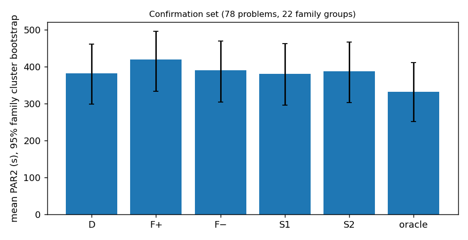

# Goal v5 最终报告：寻找能识别三种 flag 优势实例的新观测

日期：2026-10-23（UTC）。分支 `research/forcephase-study`。

- **执行目标**：[Agent Goal v5](../../docs/AGENT_GOAL_OBSERVATIONS_V5.md)。
- **协议**：[OBSERVATION_PROTOCOL_V5.md](../../docs/OBSERVATION_PROTOCOL_V5.md)，在任何 v5 新求解之前提交（`fcf660e`）；偏离记录见协议第 11 节。
- **确认前冻结**：提交 `e832b94`，标签 `v5-freeze`。

## 摘要

本阶段把“先观察、再从 D / F+ / F− 中选一次”的观察方式从 v4 的 28 个静态计数和 1 个 D 试跑臂，扩展到候选库中的 50 项新观测，外加 1 项部分实施，按注册表分类覆盖 A–G 七类：

- 短子句加权极性、根传播残余式；
- 同变量双边传播、贪心浅前瞻；
- 二元蕴含图与等价、社区、符号配对与 WL；
- D/F+/F− 三动作配对短试跑（0.2 s、0.5 s、512 冲突）；
- 修正后的相位轨迹与学习子句极性；
- 局部搜索。

这些观测分装成 11 个观察包，用带“默认回退门”的绝对成本读出器（ridge、浅树）做家族分组嵌套交叉验证，再选出两个策略做真实部署和有限确认。全部观察 CPU 都计入成本。

**主要结论**（dev 401 题的外层 OOF，以及确认集）：

1. **没有任何观察方式可靠地优于“始终 D”**：
   - 27 个登记比较的净收益都在 −2.2% 到 +0.0% 之间，没有一个区间整体大于 0；
   - 最好的 R09|RG（局部搜索加 ridge 门）在 dev 真实部署中为 −0.25% [−1.8, +1.2]；
   - 在 78 题确认集上为 +0.4% [−4.8, +6.0]，由几次个别事件决定。

   作为参照，事后最优在 dev 上为 +12.0%，在确认集上为 +13.2%。
2. **新观测没有显示出增量**：同一读出器下，没有一个观察包相对“只有 S28”有区间不含 0 的改进；有 10 个反而显著更差。所有新特征与胜负的单变量关系仍然很弱，最大 |ρ| = 0.29；966 个检验中只有 4 个通过描述性一致性筛查。
3. **决策方式相对 v4 有改进，但只是更会“守住 D”**：在同一输入上，新的门控读出器比 v4 的 logistic / 成本树每题好 7–28 秒，33 个配对中有 22 个的区间大于 0。v4 的损失主要来自少数“D 能解、偏离后超时”的错误偏离（V0 分析），门控把这些损失大部分收回；但偏离时的精度仍只有 0–0.5，所以变不成正收益。
4. **两个需要修正的工程缺陷**：
   - 局部搜索观测以 CPU 时间为预算，不能逐次复现：部署时 2% 的决策翻转；
   - 大公式上观察经常触顶：确认集有 48/78 题被强制回退 D。

   另外：
   - 单 seed 下 D 的运行时间对 seed 敏感（5%–95% 跨度约 0.5–2 倍），约三分之一的“D 优势”标签在换 seed 后改变；
   - 截止线附近的计时噪声可以让单题在“解出 / 超时”之间翻转。

   这些都限制了任何选择器在这个面板上能稳定识别的收益。

这是一个**有界的负结果**：在已实施的观测、读出器和这个五年面板上，没有找到可部署、可复现、优于 D 的一次性选择方式。它不证明所有识别方式都不可能——26 项观测未实施，确认集也只有 78 题、22 个家族组，而且这些家族在 v4 test 中曝光过。

## Summary (English)

Goal v5 widened the "observe cheaply, then choose D / F+ / F− once" study from v4's 28 static counts and one D probe to 50 new observations, plus one partial, covering seven classes (A–G) of the catalog:

- clause-length-weighted polarity and the root-propagation residual;
- two-sided bounded BCP and greedy shallow lookahead;
- implication-graph, community, signed-pair and WL structure;
- paired 0.2 s / 0.5 s / 512-conflict probes of all three actions;
- corrected phase-memory and learned-clause-sign telemetry;
- local search.

The observations were bundled into 11 packages. Each package was paired with absolute-cost readers that keep D unless the predicted gain clears an inner-CV threshold (ridge and shallow trees), evaluated by nested family-grouped CV on the 401-instance dev panel with every observation CPU-second charged. The two strategies selected by the protocol were then deployed for real on dev and on a frozen 78-problem confirmation set.

Results:

- **No observation package beats always-D.** Across the 27 registered comparisons the gain ranges from −2.2% to +0.0%, with no confidence interval above zero. The best one (local search with a ridge gate) gives −0.25% [−1.8, +1.2] in real deployment on dev and +0.4% [−4.8, +6.0] on the confirmation set. The hindsight oracle is +12–13%.
- **No package improves on the 28 static features with the same reader.**
- **Univariate signals stay weak** (max |ρ| = 0.29).
- **The gated readers improve clearly on v4's readers, but only by deviating far less.** They beat the v4 readers on the same inputs by 7–28 s per instance (22 of 33 paired CIs are above zero), yet their deviations are still mostly wrong.
- **Engineering defects found in deployment:**
  - CPU-time-budgeted local search makes its features non-reproducible, which flipped 2% of the decisions;
  - observation caps are often hit on large formulas, so 48 of 78 confirmation problems fell back to D.
- **Label noise limits any selector here.** D's runtime is seed-sensitive, and timing noise near the cutoff flips individual solves.

This is a bounded negative result for the observations that were implemented, not proof that identification is impossible.

## 1. 问题、范围与曝光

**动作**：

| 名称 | 参数 |
| --- | --- |
| D | `--phase=1 --forcephase=0` |
| F+ | `--phase=1 --forcephase=1` |
| F− | `--phase=0 --forcephase=1` |

- 求解器为 CaDiCaL c607304。正式求解用 `build/fpc`，单题 T = 300 CPU s，未解出记 PAR2 600，seed 0。
- 观察可以有多个临时试跑臂，但正式配置只选一次。

**数据**：
- **开发**：v4 的 dev 401（126 个家族组），外层 5 折与 v4 完全相同。
- **工程面板**：96 题。
- **确认集**：78 题、22 个家族组，按协议规则只用元数据选出。

**曝光**：
- v5 开始前已经看过 v4 的全部结果，包括旧 test99。
- 旧 test99 在 v5 中没有用于任何选择。
- 确认集的家族与 dev 不相交，但这些家族在 v4 test 中出现过。

## 2. 做了什么

| 阶段 | 内容 | 报告 |
| --- | --- | --- |
| V0 | 旧观测的真实覆盖、v4 选择器逐题损失分解（12 个候选精确复现）、权重与标签、计时；V1 的 seed 重复 | [COVERAGE_AND_ERRORS.md](COVERAGE_AND_ERRORS.md) |
| 协议 | 观察包 R00–R11、成本、读出器网格、断言规则、预算；注册表覆盖 80 项观测与 12 种方法 | [协议](../../docs/OBSERVATION_PROTOCOL_V5.md)、[registry.json](../../configs/observations_v5/registry.json) |
| V1 | 观测工具与观测版求解器；等价门（搜索逐项相同）；覆盖、开销、κ；H01 / H02 编码诊断；修正两处工程缺陷后重新采集 | [V1_ENGINEERING.md](V1_ENGINEERING.md) |
| V2 | 507 个新特征的筛查；27 个登记比较与对照、增量与读出器消融、回退曲线、OOD 分解；按规则选出 S1 / S2 | [OBSERVATION_SCREEN.md](OBSERVATION_SCREEN.md)、[SELECTION_AND_ABLATION.md](SELECTION_AND_ABLATION.md) |
| V3 | dev 真实部署（折模型，802 次，其中 1 次补跑）；冻结后在确认集上运行三个固定动作与两个 wrapper | [DEPLOYMENT.md](DEPLOYMENT.md) |

## 3. 主要结果

### 3.1 V0：旧观测与旧选择器

- **覆盖**：v4 选中的 0.1 s 试跑上，30% 的 dev 实例还没进入搜索，checkpoint 特征缺失 55%；到 2 s 时覆盖率升到约 90%，但 v4 的 2 s 候选同样不如 D。所以预算太短只是问题的一部分。
- **损失分解**：12 个 v4 候选的错误偏离每题损失 15–38 秒，正确偏离每题只省 6–14 秒，观察开销 ≤ 1.3 秒。前 10 大损失占 78–80%，而且这 10 题全部是“D 能解、所选动作超时”。
- **logistic 的 log 倍数权重**：与绝对秒数高度同序（ρ = 0.86），不是主要问题；缺的是“证据不足时保留 D”。

### 3.2 选择与消融（dev 401，外层 OOF）

| 组合 | PAR2 | 相对始终 D |
| --- | ---: | --- |
| 始终 D（不观察） | 382.10 | — |
| 事后最优（不可部署） | 336.25 | +12.0% [+8.3, +16.0] |
| v4 静态 logistic（复现） | 392.95 | −2.8% [−6.1, +0.1] |
| v4 0.1 s 试跑 logistic（复现） | 387.28 | −1.4% [−5.5, +2.2] |
| S28 + RG（新读出器、旧输入） | 383.29 | −0.3% [−1.8, +0.9] |
| **R09 + RG**（局部搜索；S1） | 382.07 | +0.0% [−1.3, +1.3] |
| R03 + RG（蕴含图 / 等价） | 383.75 | −0.4% [−2.2, +0.7] |
| R05 + RG（D 2 s 相位轨迹） | 383.47 | −0.4% [−1.1, +0.4] |
| R08 + RG（三动作 512 冲突） | 384.17 | −0.5% [−1.7, +0.4] |
| R07 + RG（三动作 0.5 s） | 388.44 | −1.7% [−3.5, −0.3] |
| R11 + TG（有条件试跑；S2，从不偏离） | 382.97 | −0.2% [−0.7, −0.0] |
| 旧读出器在各新输入上 | 393–411 | −1.4% 到 −7.6% |

- **观测增量**（同一读出器下，包相对 S28）：24 个配对中 0 个显著为正，10 个显著为负。
- **决策方式**（同一输入下，新读出器相对 v4 读出器）：33 个配对中 22 个显著为正，0 个显著为负。


### 3.3 真实部署与确认

| 场景 | 策略 | 真实结果 |
| --- | --- | --- |
| dev 401（折模型） | S1 = R09\|RG | −0.25% [−1.77, +1.15]（401 题；1 次运行因集群磁盘写满而失败，恢复后补跑） |
| dev 401（折模型） | S2 = R11\|TG | −0.01% [−0.58, +0.57] |
| 确认集 78 题 | D / F+ / F− | PAR2 382.2 / 419.6（−9.8%）/ 390.4（−2.1%） |
| 确认集 78 题 | S1 | +0.4% [−4.8, +6.0]，与 D 同样解出 33 题 |
| 确认集 78 题 | S2 | −1.4% [−3.6, −0.2] |
| 确认集 78 题 | 事后最优 | +13.2% [+4.5, +24.6] |

- **离线模拟可靠**：真实成本与模拟成本逐题中位差为 0；wrapper 的额外开销中位 0.086 s，在预留的 0.1 s 之内。
- **S1 在确认集上的 +0.4%**：由一次正确的 F− 偏离（+557 s）、一次错误的 F− 偏离（−387 s）、一次截止线附近的计时运气（+341 s）和一次被观察开销推过截止（−310 s）大致抵消而成。



## 4. 结论分类

| 类别 | 内容 |
| --- | --- |
| **已知旧结果（v4，复核）** | D 是 dev 与旧 test 上最好的固定动作；v4 的 12 个候选都不如 D；损失集中在少数错误偏离（本阶段精确复现并分解）。 |
| **新实测** | 50 项新观测加 1 项部分实施、11 个包、27 个登记比较都没有可靠优于 D。在 dev 上，同一读出器下没有一个包相对 S28 有增量。门控读出器显著好于 v4 读出器（只是更少偏离）。真实部署与模拟一致。确认集上 S1 为 +0.4% [−4.8, +6.0]，S2 为 −1.4%。D 的运行时间对 seed 敏感，F± 几乎不受 seed 影响。观测版与正式二进制搜索逐项相同。局部搜索观测不可复现。 |
| **相关性（描述性，非部署规则）** | 0.2 s 试跑中 F− 学到的子句比 D 更长、glue 更高的实例上，F− 更慢（ρ = +0.29）。D 试跑中 chrono 回退比例高的实例上，F+ 更慢（ρ = +0.29；家族内只有 +0.05）。F− 优势组的正负双边传播与蕴含可达性更对称，反向等价比例更低。 |
| **机制假说（未经干预验证）** | (a) 短试跑中哪个动作学得更好，与最终胜负弱同向。(b) F− 占优的实例上正负方向的传播约束较对称，统一的负向决策不会落入“一侧传播远强于另一侧”的结构。(c) F± 不只是改变决策符号：翻转公式后，搜索只有 30/85 题精确镜像，说明 CaDiCaL 的其余部分也依赖符号约定。 |
| **未实施** | 候选库中 26 项（多为 P2/P3）：A06、A08、B06、B08、B09、C05–C07、D06、D08、D09、E08、E10、F02、F05–F07、F09、G05、G07、G08、H03、H05–H08；方法 M05、M08、M12；C03、M07、M09、M11 只部分实施。未实施不等于已否定，理由见注册表。 |

## 5. 局限

- **确认集**：确认集是全新实例，但不是全新家族——所有 2022–2026 主赛道家族组都已出现在 v4 面板中。规模也只有 78 题、22 组，且偏向 2022 年（40 题）和大公式（51 题 > 100 MB）。其中 48 题的观察不完整，被强制回退 D。所以确认集上的结论只能算“有限确认，尚未独立确认”。
- **单 seed 标签**：dev 标签来自单个 seed。seed 重复显示 D 优势标签不稳定，近似最优的收益上限因此被高估。截止线附近的计时噪声（同一搜索 CPU 的 5%–95% 为 0.93–1.05 倍）能让单题在“解出 / 超时”之间翻转。
- **观测预算与读出器**：
  - 观测都按预先固定的预算和上限实现，没有为了提高覆盖去调预算；
  - 局部搜索观测的 CPU 时间预算导致不可复现，是本阶段应修而未在冻结前发现的缺陷；
  - 读出器网格固定且很小，没有做无界超参数搜索。
- **补跑**：dev 部署中有 1 次 S1 运行因集群共享的 `/mnt/data` 写满（2026-10-23 约 07:28 UTC，800T/800T）而失败。磁盘恢复后，用同一代码版本单独补跑；它与同批其他运行不在同一节点、同一时段，计时条件略有不同。

## 6. 交付物与复现

**交付物**：
- **协议与注册表**：
  - `docs/OBSERVATION_PROTOCOL_V5.md`；
  - `configs/observations_v5/registry.json`：80 项观测和 12 种方法的状态、理由、代码与结果，由 `scripts/observations_v5/registry.py --results results/observations_v5/registry_results.json` 生成。
- **报告**：`reports/observations_v5/` 下的 COVERAGE_AND_ERRORS、V1_ENGINEERING、OBSERVATION_SCREEN、SELECTION_AND_ABLATION、DEPLOYMENT 与本文。
- **代码**：
  - `tools/obsprofile.c`；
  - `patches/cadical-obs.patch` 与 `solver/obs/`（构建变体 `obs`）；
  - `scripts/observations_v5/`：采集 `obsrun.py`、特征 `obsfeat.py`、wrapper `v5_wrapper.py`、建模 `v5select.py`、报告 `v5report.py` / `v5screen.py` / `v5deploy.py` / `v1_engineering.py`。
- **冻结**：`configs/observations_v5/frozen/`，其中 `FREEZE.json` 记录 sha256。
- **原始记录**：`$FP_DATA/runs/observations_v5/` 下的 JSON 记录，试跑臂和 wrapper 的原始输出以 gzip 保存。

**最小复现命令**（2026-10-23 在 gs-srun 容器中实际执行过，输出保存在 `$FP_DATA/v5_smoke/repro/output.txt`）：

```bash
cd /mnt/home/zhaofeng/workspace/online-tuning-forcephase && mkdir -p /mnt/data/zhaofeng/projects/workspace/online-tuning-forcephase/v5_smoke/repro && source /mnt/data/shared/config/env.sh && GENESIS_IMAGE_VER=1_26 gs-srun --partition=cpu-low --nodes=1 --ntasks=1 --cpus-per-task=4 --time=00:20:00 bash -c 'cd /mnt/home/zhaofeng/workspace/online-tuning-forcephase && H=474e9594ec7885cb1bebf66073eb2de2 && xz -dc /mnt/data/zhaofeng/projects/workspace/online-tuning-forcephase/benchmarks/cnf/$H.cnf.xz > /tmp/v5repro.cnf && build/tools/obsprofile --sections=resid,ls --cap=3 /tmp/v5repro.cnf | python3 -c "import json,sys; d=json.load(sys.stdin); print({k:(v[\"status\"],round(v[\"cpu\"],3)) for k,v in d[\"sections\"].items() if v[\"status\"]!=\"off\"}); print({k:d[\"features\"][k] for k in (\"g01_best_zero_log\",\"g01_best_one_log\",\"g03_density_zero\",\"g04_agree_zero_one\")})" && rm -rf /tmp/v5w && python3 scripts/observations_v5/v5_wrapper.py --strategy configs/observations_v5/frozen/S1_final.json --cnf /tmp/v5repro.cnf --timeout 300 --workdir /tmp/v5w && python3 -c "import json; r=json.load(open(\"/tmp/v5w/result.json\")); print(\"path\", r[\"path\"], \"action\", r[\"action\"], \"gains\", {k: round(v,2) for k,v in r[\"gains\"].items()}, \"exit\", r[\"answer_exit\"], \"observation+wrapper cpu\", round(r[\"overhead_cpu\"],3), \"formal cpu\", round(r[\"formal\"][\"cpu\"],2))"' 2>&1 | grep -v "^Genesis" | tee /mnt/data/zhaofeng/projects/workspace/online-tuning-forcephase/v5_smoke/repro/output.txt
```

输出（`output.txt` 原文）：

```
{'parse': ('ok', 0.001), 's28': ('ok', 0.0), 'resid': ('ok', 0.001), 'ls': ('ok', 0.073)}
{'g01_best_zero_log': 1.11394, 'g01_best_one_log': 1.23045, 'g03_density_zero': 0.362593, 'g04_agree_zero_one': 0.574871}
path reader action D gains {'Fp': -99.81, 'Fm': -71.31} exit 10 observation+wrapper cpu 0.103 formal cpu 4.17
```

实际输出要点：
- obsprofile 各段状态为 ok，局部搜索段 0.073 s。
- wrapper 读出器给出的预测收益为 F+ −99.8 s、F− −71.3 s，所以保留 D。
- 正式 D 解出（exit 10），用时 4.17 s；v4 固定 D 运行为 4.16 s。观察加 wrapper 合计 0.103 s。

**完整流水线**：

```bash
# 采集（需先按协议构建 build/obs 与 build/tools/obsprofile）
scripts/observations_v5/slurm_obsrun.sh 1 48 01:00:00 -- eqv --hashes configs/observations_v5/eng_panel.txt
scripts/observations_v5/slurm_obsrun.sh 1 48 01:00:00 -- obs --hashes configs/three_way/dev_hashes.txt
scripts/observations_v5/slurm_obsrun.sh 2 48 01:00:00 -- arm --hashes configs/three_way/dev_hashes.txt --tags e02,e05,ec
scripts/observations_v5/slurm_obsrun.sh 1 48 01:00:00 -- arm --hashes configs/three_way/dev_hashes.txt --tags fD --actions D

# 分析（用分析 venv 的 python）
$FP_PY scripts/observations_v5/v1_engineering.py
$FP_PY scripts/observations_v5/v5screen.py
$FP_PY scripts/observations_v5/v5select.py
$FP_PY scripts/observations_v5/v5report.py
$FP_PY scripts/observations_v5/v5export.py

# 部署与确认
scripts/observations_v5/slurm_obsrun.sh 2 48 04:00:00 -- wrap --hashes configs/three_way/dev_hashes.txt \
    --strategy-map configs/observations_v5/frozen/strategy_map_dev.json
scripts/slurm_submit.sh configs/observations_v5/v5_confirm_fixed.json 2 48 cpu-low 04:00:00
scripts/observations_v5/slurm_obsrun.sh 1 48 04:00:00 -- wrap --hashes configs/observations_v5/confirm_hashes.txt \
    --strategy configs/observations_v5/frozen/S1_final.json,configs/observations_v5/frozen/S2_final.json
$FP_PY scripts/observations_v5/v5deploy.py --confirm
```

## 7. 算力

v5 共用 82.38 CPU 核时（含作废的第一次采集、补跑和分析估计上限）；加上 v4 的 39.90，v4 之后累计 122.28 核时，上限为 200。

| 阶段 | 核时 | 计划上限 |
| --- | ---: | ---: |
| V0/V1 | 约 10 | ≤ 20 |
| V2（dev 部署 + 分析） | 约 49 | ≤ 90 |
| V3 确认 | 约 23 | ≤ 50 |

明细见 [results/observations_v5/COMPUTE.md](../../results/observations_v5/COMPUTE.md)。所有解出都通过独立检查，运行器错误 0 个。
