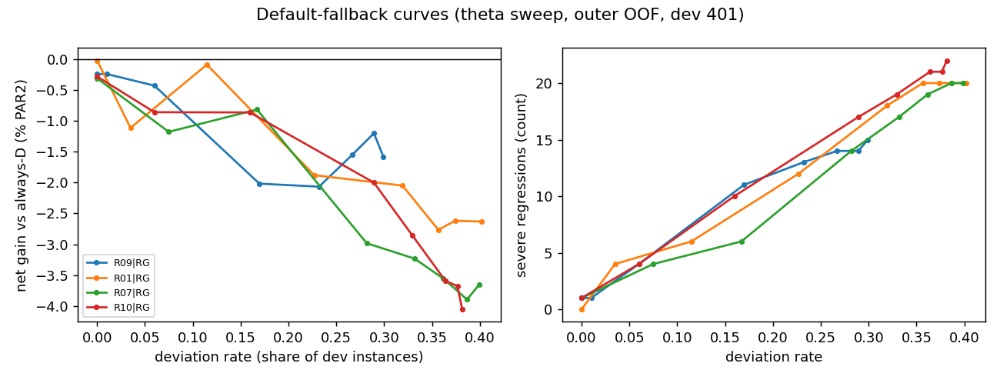
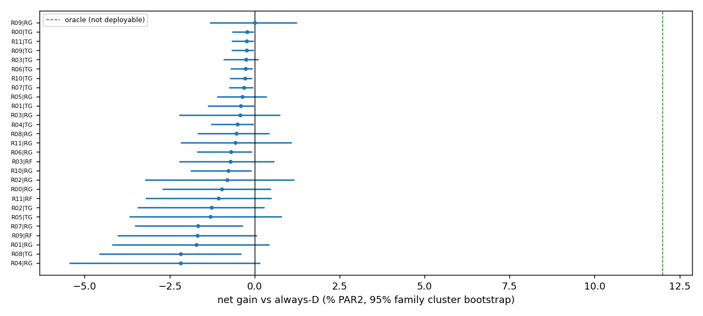

# 选择与消融表（由 `scripts/observations_v5/v5report.py` 生成）

## 1. 登记的比较（外层 5 折 OOF，dev 401）

始终 D（不观察）PAR2 = 382.10；事后最优 336.25（+12.0% [+8.3, +16.0]）。净收益 = 始终 D 的成本 − 策略成本（含全部观察 CPU），正 = 更好；区间为家族 cluster bootstrap 95%（10,000 次）。精度 = 偏离 D 的题中、比同一观察后选 D 更好的比例；错误偏离 = 这些题多付的秒数 / 401；严重回退 = D 在截止前解出而策略超时，或单题多付 ≥ 100 s。

| 包 | 内容 | 读出器 | PAR2 | 净收益（相对 D） | 偏离 F+/F− | 精度 | 正确偏离 s/题 | 错误偏离 s/题 | 严重回退 | 前 10 题占正收益 | 平均观察 CPU s |
|---|---|---|---:|---|---|---:|---:|---:|---:|---:|---:|
| R00 | v4 静态 + D 0.1 s 试跑（v4 输入） | RG | 385.78 | -1.0% [-2.7, +0.5] | 5/1 | 0.17 | 1.26 | 4.10 | 4 | 100% | 0.24 |
| R00 | v4 静态 + D 0.1 s 试跑（v4 输入） | TG | 382.94 | -0.2% [-0.7, -0.0] | 0/0 | nan | 0.00 | 0.00 | 1 | nan% | 0.24 |
| R01 | 加权极性 + 根传播残余式 | RG | 388.64 | -1.7% [-4.2, +0.4] | 27/13 | 0.25 | 3.51 | 9.99 | 8 | 100% | 0.16 |
| R01 | 加权极性 + 根传播残余式 | TG | 383.69 | -0.4% [-1.4, -0.0] | 4/0 | 0.00 | 0.00 | 1.53 | 1 | nan% | 0.16 |
| R02 | 双边传播 + 贪心路径 | RG | 385.18 | -0.8% [-3.2, +1.2] | 18/5 | 0.17 | 3.62 | 6.64 | 5 | 100% | 0.15 |
| R02 | 双边传播 + 贪心路径 | TG | 386.92 | -1.3% [-3.4, +0.3] | 19/11 | 0.17 | 1.30 | 6.07 | 5 | 100% | 0.15 |
| R03 | 蕴含图 / 组件 / 等价 | RG | 383.75 | -0.4% [-2.2, +0.7] | 4/3 | 0.14 | 1.09 | 2.67 | 2 | 100% | 0.16 |
| R03 | 蕴含图 / 组件 / 等价 | TG | 383.05 | -0.2% [-0.9, +0.1] | 20/8 | 0.07 | 0.17 | 1.07 | 1 | 100% | 0.16 |
| R03 | 蕴含图 / 组件 / 等价 | RF | 384.84 | -0.7% [-2.2, +0.6] | 9/0 | 0.11 | 1.26 | 3.94 | 3 | 100% | 0.16 |
| R04 | 社区 / 符号配对 / WL | RG | 390.43 | -2.2% [-5.4, +0.2] | 22/0 | 0.32 | 1.43 | 8.93 | 7 | 100% | 0.21 |
| R04 | 社区 / 符号配对 / WL | TG | 384.00 | -0.5% [-1.3, -0.0] | 0/5 | 0.00 | 0.00 | 1.07 | 2 | nan% | 0.21 |
| R05 | D 2 s 相位轨迹 | RG | 383.47 | -0.4% [-1.1, +0.4] | 2/0 | 0.50 | 0.94 | 0.07 | 2 | 100% | 2.04 |
| R05 | D 2 s 相位轨迹 | TG | 387.04 | -1.3% [-3.7, +0.8] | 25/19 | 0.16 | 4.24 | 6.94 | 7 | 100% | 2.04 |
| R06 | 三动作各 0.2 s | RG | 384.76 | -0.7% [-1.7, -0.1] | 3/1 | 0.00 | 0.00 | 1.63 | 2 | nan% | 0.75 |
| R06 | 三动作各 0.2 s | TG | 383.13 | -0.3% [-0.7, -0.1] | 0/0 | nan | 0.00 | 0.00 | 1 | nan% | 0.75 |
| R07 | 三动作各 0.5 s | RG | 388.44 | -1.7% [-3.5, -0.3] | 30/15 | 0.04 | 1.09 | 6.26 | 7 | 100% | 1.61 |
| R07 | 三动作各 0.5 s | TG | 383.27 | -0.3% [-0.8, -0.0] | 0/0 | nan | 0.00 | 0.00 | 1 | 100% | 1.61 |
| R08 | 三动作各 512 冲突 | RG | 384.17 | -0.5% [-1.7, +0.4] | 3/15 | 0.28 | 1.24 | 1.47 | 3 | 100% | 0.81 |
| R08 | 三动作各 512 冲突 | TG | 390.38 | -2.2% [-4.6, -0.4] | 23/14 | 0.16 | 0.91 | 7.37 | 7 | 100% | 0.81 |
| R09 | 局部搜索 | RG | 382.07 | +0.0% [-1.3, +1.3] | 11/2 | 0.15 | 2.48 | 1.55 | 2 | 100% | 0.41 |
| R09 | 局部搜索 | TG | 383.01 | -0.2% [-0.7, -0.0] | 0/0 | nan | 0.00 | 0.00 | 1 | nan% | 0.41 |
| R09 | 局部搜索 | RF | 388.51 | -1.7% [-4.0, +0.1] | 13/2 | 0.07 | 1.26 | 6.77 | 6 | 100% | 0.41 |
| R10 | R01 + R02 + R06 | RG | 385.06 | -0.8% [-1.9, -0.1] | 5/1 | 0.00 | 0.00 | 1.90 | 3 | nan% | 0.80 |
| R10 | R01 + R02 + R06 | TG | 383.16 | -0.3% [-0.7, -0.1] | 0/0 | nan | 0.00 | 0.00 | 1 | nan% | 0.80 |
| R11 | R10 静态 + 有条件 R06 | RG | 384.25 | -0.6% [-2.2, +1.1] | 17/2 | 0.16 | 3.23 | 4.48 | 5 | 100% | 0.41 |
| R11 | R10 静态 + 有条件 R06 | TG | 382.97 | -0.2% [-0.7, -0.0] | 0/0 | nan | 0.00 | 0.00 | 1 | nan% | 0.35 |
| R11 | R10 静态 + 有条件 R06 | RF | 386.18 | -1.1% [-3.2, +0.5] | 9/2 | 0.09 | 1.26 | 4.48 | 4 | 100% | 0.33 |

登记比较 25 个（R01–R11 × RG/TG = 22，加上 R00 × RG/TG = 2，以及晋级包上的 RF 3 个）。晋级（按 RG/TG 较好者的 OOF 净收益）：R09, R11, R03。

## 2. 对照

| 名称 | PAR2 | 净收益 | 偏离 F+/F− | 精度 | 严重回退 |
|---|---:|---|---|---:|---:|
| always-D | 382.10 | +0.0% [+0.0, +0.0] | 0/0 |  | 0 |
| oracle | 336.25 | +12.0% [+8.3, +16.0] | 64/55 | 1.00 | 0 |
| v4static|v4-logreg | 392.95 | -2.8% [-6.1, +0.1] | 52/46 | 0.23 | 14 |
| v4static|v4-tree1 | 404.28 | -5.8% [-10.8, -1.3] | 75/9 | 0.14 | 22 |
| v4static|v4-tree3 | 405.43 | -6.1% [-11.9, -0.9] | 82/81 | 0.20 | 30 |
| R00|v4-logreg | 387.28 | -1.4% [-5.5, +2.2] | 74/57 | 0.24 | 12 |
| R00|v4-tree1 | 404.80 | -5.9% [-10.6, -1.8] | 97/0 | 0.19 | 24 |
| R00|v4-tree3 | 406.75 | -6.5% [-11.6, -1.8] | 113/53 | 0.16 | 28 |
| S28|RG | 383.29 | -0.3% [-1.8, +0.9] | 5/0 | 0.20 | 2 |
| S28|TG | 382.14 | -0.0% [-0.0, -0.0] | 0/0 |  | 0 |
| S28|v4-logreg | 394.02 | -3.1% [-6.4, -0.1] | 53/47 | 0.23 | 15 |
| S28|v4-tree1 | 404.27 | -5.8% [-10.8, -1.3] | 75/9 | 0.14 | 22 |
| S28|v4-tree3 | 405.43 | -6.1% [-11.9, -0.9] | 82/81 | 0.20 | 30 |
| R01|v4-logreg | 401.77 | -5.1% [-9.5, -1.5] | 65/60 | 0.18 | 21 |
| R01|v4-tree1 | 399.59 | -4.6% [-9.4, -0.2] | 80/0 | 0.19 | 18 |
| R01|v4-tree3 | 408.98 | -7.0% [-12.6, -2.4] | 59/58 | 0.13 | 26 |
| R02|v4-logreg | 394.60 | -3.3% [-7.7, +0.6] | 46/54 | 0.19 | 19 |
| R02|v4-tree1 | 406.60 | -6.4% [-11.6, -1.7] | 88/0 | 0.19 | 24 |
| R02|v4-tree3 | 404.80 | -5.9% [-10.8, -1.5] | 88/32 | 0.16 | 23 |
| R03|v4-logreg | 397.75 | -4.1% [-7.8, -0.9] | 61/57 | 0.16 | 19 |
| R03|v4-tree1 | 389.75 | -2.0% [-6.6, +1.7] | 93/0 | 0.23 | 13 |
| R03|v4-tree3 | 401.19 | -5.0% [-9.7, -0.8] | 72/61 | 0.20 | 23 |
| R04|v4-logreg | 397.33 | -4.0% [-8.8, +0.1] | 56/92 | 0.22 | 20 |
| R04|v4-tree1 | 396.37 | -3.7% [-8.2, -0.1] | 46/21 | 0.16 | 16 |
| R04|v4-tree3 | 406.11 | -6.3% [-12.1, -1.0] | 88/77 | 0.22 | 32 |
| R05|v4-logreg | 394.30 | -3.2% [-6.8, +0.1] | 76/66 | 0.23 | 23 |
| R05|v4-tree1 | 394.84 | -3.3% [-7.4, +0.3] | 65/21 | 0.20 | 17 |
| R05|v4-tree3 | 409.11 | -7.1% [-12.4, -2.0] | 90/64 | 0.19 | 30 |
| R06|v4-logreg | 393.35 | -2.9% [-7.4, +1.0] | 79/47 | 0.20 | 18 |
| R06|v4-tree1 | 410.00 | -7.3% [-12.5, -2.8] | 106/0 | 0.18 | 28 |
| R06|v4-tree3 | 401.46 | -5.1% [-9.6, -1.0] | 91/59 | 0.17 | 25 |
| R07|v4-logreg | 400.18 | -4.7% [-9.4, -0.7] | 93/63 | 0.17 | 25 |
| R07|v4-tree1 | 411.20 | -7.6% [-13.1, -2.7] | 84/24 | 0.17 | 30 |
| R07|v4-tree3 | 409.51 | -7.2% [-12.3, -2.7] | 120/28 | 0.14 | 27 |
| R08|v4-logreg | 408.91 | -7.0% [-12.3, -2.1] | 103/73 | 0.19 | 29 |
| R08|v4-tree1 | 397.43 | -4.0% [-8.6, -0.3] | 29/47 | 0.25 | 16 |
| R08|v4-tree3 | 400.40 | -4.8% [-9.6, -0.8] | 95/43 | 0.24 | 21 |
| R09|v4-logreg | 398.02 | -4.2% [-8.0, -0.7] | 82/54 | 0.17 | 21 |
| R09|v4-tree1 | 405.52 | -6.1% [-11.2, -1.5] | 93/0 | 0.20 | 25 |
| R09|v4-tree3 | 407.91 | -6.8% [-12.3, -1.5] | 85/52 | 0.16 | 29 |
| R10|v4-logreg | 398.81 | -4.4% [-8.2, -0.8] | 61/65 | 0.16 | 21 |
| R10|v4-tree1 | 409.07 | -7.1% [-12.2, -2.6] | 102/0 | 0.19 | 26 |
| R10|v4-tree3 | 401.36 | -5.0% [-9.9, -0.8] | 85/62 | 0.19 | 27 |

`v4static|v4-logreg` 与 `R00|v4-logreg` 应与 v4 的 [SELECTOR_CV](../three_way/SELECTOR_CV.md) 完全相同（392.95 与 387.28）。

## 3. 消融

### 3.1 新观测是否有增量：同一读出器下，包 P 相对“只有 S28”

差值 = S28 成本 − 包 P 成本（秒/题，正 = 包 P 更好），配对家族 cluster bootstrap 95% 区间。

| 包 | RG：差值 [区间] | TG：差值 [区间] |
|---|---|---|
| R00 | -2.48 [-6.62, -0.05] * | -0.80 [-2.52, -0.04] * |
| R01 | -5.35 [-14.82, +2.17] | -1.55 [-5.22, -0.02] * |
| R02 | -1.89 [-9.65, +3.62] | -4.78 [-13.13, +1.14] |
| R03 | -0.46 [-8.77, +6.85] | -0.91 [-3.45, +0.45] |
| R04 | -7.14 [-20.72, +3.66] | -1.86 [-4.84, -0.04] * |
| R05 | -0.18 [-5.87, +6.06] | -4.90 [-14.05, +3.07] |
| R06 | -1.47 [-7.63, +4.92] | -0.99 [-2.72, -0.21] * |
| R07 | -5.15 [-14.11, +2.89] | -1.13 [-2.88, -0.11] * |
| R08 | -0.87 [-7.47, +5.84] | -8.24 [-17.46, -1.48] * |
| R09 | +1.22 [-4.77, +7.47] | -0.87 [-2.59, -0.09] * |
| R10 | -1.77 [-8.27, +4.71] | -1.02 [-2.74, -0.23] * |
| R11 | -0.96 [-9.18, +7.26] | -0.83 [-2.56, -0.06] * |

`*` = 区间不含 0。

### 3.2 决策方式是否改善：同一输入上，新读出器相对 v4 旧读出器

差值 = 旧读出器成本 − 新读出器成本（正 = 新读出器更好）。RG 对 v4 logistic（都是线性），TG 对 v4 深度 3 成本树（都是树）。

| 包 | RG − v4-logreg | TG − v4-tree3 | TG − v4-tree1 |
|---|---|---|---|
| S28 | +10.72 [+0.62, +22.29] * | +23.29 [+3.49, +45.41] * | +22.13 [+4.82, +41.08] * |
| R01 | +13.13 [+1.02, +27.62] * | +25.29 [+7.27, +46.40] * | +15.90 [-1.05, +34.47] |
| R02 | +9.42 [-4.42, +24.82] | +17.87 [+0.84, +36.34] * | +19.67 [+1.13, +39.74] * |
| R03 | +14.00 [+2.51, +27.12] * | +18.14 [+1.87, +36.37] * | +6.70 [-7.09, +23.81] |
| R04 | +6.90 [-13.02, +27.73] | +22.11 [+1.65, +44.56] * | +12.37 [-1.24, +29.17] |
| R05 | +10.83 [-1.81, +24.48] | +22.07 [+5.08, +40.56] * | +7.80 [-3.21, +20.40] |
| R06 | +8.59 [-5.95, +25.31] | +18.33 [+3.21, +35.56] * | +26.87 [+9.74, +46.53] * |
| R07 | +11.74 [-4.32, +29.98] | +26.24 [+9.43, +45.59] * | +27.92 [+9.51, +48.98] * |
| R08 | +24.75 [+5.94, +44.64] * | +10.02 [-2.58, +24.38] | +7.05 [-4.21, +20.09] |
| R09 | +15.95 [+3.15, +29.94] * | +24.91 [+4.83, +46.09] * | +22.51 [+4.82, +41.75] * |
| R10 | +13.74 [+0.84, +27.89] * | +18.20 [+2.03, +36.75] * | +25.91 [+8.88, +45.58] * |

## 4. 主要策略（协议第 9 节规则）

- **S1** = 全部登记比较中 OOF 净收益最高者：`R09|RG`，+0.0% [-1.3, +1.3]，PAR2 382.07。
- **S2** = 观察类型与 S1 相反（含试跑）的组合中最好者：`R11|TG`，-0.2% [-0.7, -0.0]，PAR2 382.97。
- 两者的净收益都不显著大于 0（区间含 0 或为负）；按协议仍部署两者，以检验真实开销与回退行为。

## 5. 默认回退曲线（各折的其他超参数固定，统一扫描 θ）

| 策略 | θ | 净收益 % | 偏离率 | 严重回退 |
|---|---:|---:|---:|---:|
| R09|RG | 0 | -1.6% | 29.9% | 15 |
| R09|RG | 2 | -1.2% | 28.9% | 14 |
| R09|RG | 5 | -1.5% | 26.7% | 14 |
| R09|RG | 10 | -2.1% | 23.2% | 13 |
| R09|RG | 20 | -2.0% | 17.0% | 11 |
| R09|RG | 50 | -0.4% | 6.0% | 4 |
| R09|RG | 100 | -0.2% | 1.0% | 1 |
| R09|RG | ∞ | -0.2% | 0.0% | 1 |

## 6. 按训练分布距离（H04）与优势组分解

OOD 距离 = 外层训练折 S28 标准化空间中到 5 个最近训练实例的平均距离，按三分位分成近/中/远。

| 策略 | 近：净收益 s/题 | 中 | 远 |
|---|---:|---:|---:|
| R09|RG | -2.29 | +2.86 | -0.46 |
| R11|TG | -2.32 | -0.10 | -0.19 |

| 策略 | 组 | n | 偏离到 F+ | 偏离到 F− | 净收益 s/题 |
|---|---|---:|---:|---:|---:|
| R09|RG | D 优势 | 62 | 2 | 0 | -15.23 |
| R09|RG | F+ 优势 | 38 | 2 | 1 | +26.02 |
| R09|RG | F− 优势 | 24 | 0 | 0 | -0.26 |
| R09|RG | 接近 | 75 | 1 | 0 | -0.36 |
| R09|RG | 全部超时 | 202 | 6 | 1 | +0.00 |
| R11|TG | D 优势 | 62 | 0 | 0 | -5.13 |
| R11|TG | F+ 优势 | 38 | 0 | 0 | -0.16 |
| R11|TG | F− 优势 | 24 | 0 | 0 | -0.26 |
| R11|TG | 接近 | 75 | 0 | 0 | -0.27 |
| R11|TG | 全部超时 | 202 | 0 | 0 | +0.00 |

