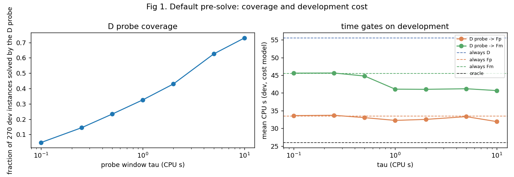
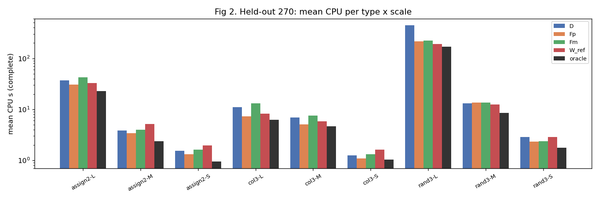
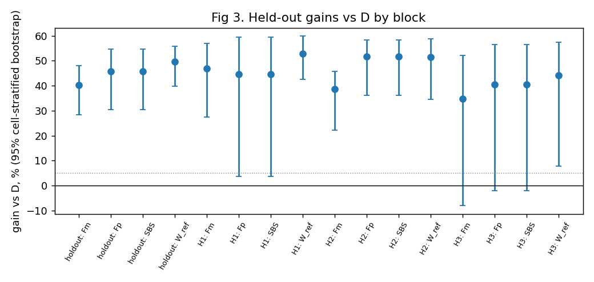
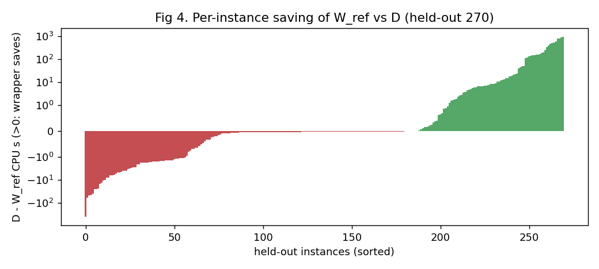
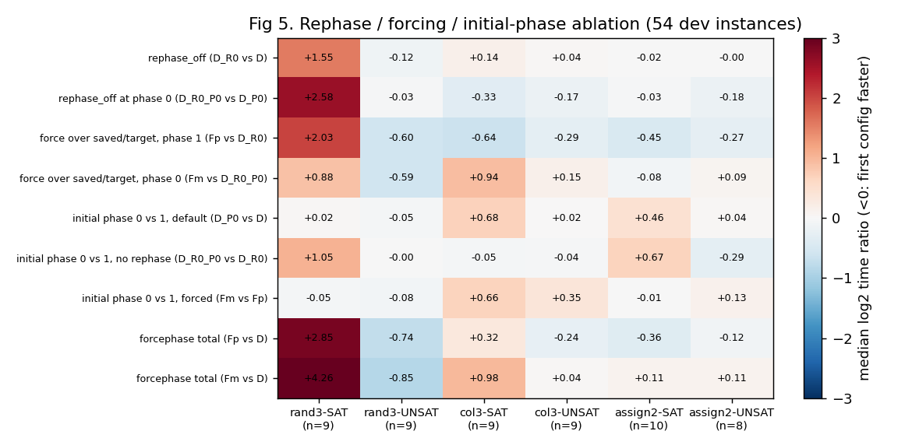
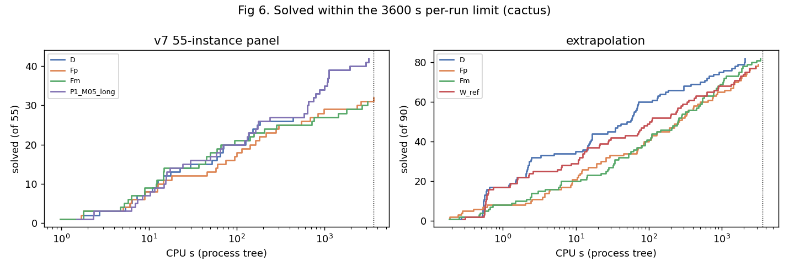

# Goal v9 最终报告：默认短预求解后的三选一

日期：2026-10-24（UTC）。分支 `research/forcephase-study`。资源政策：无核时上限（[RESOURCE_POLICY.md](../../docs/RESOURCE_POLICY.md)）。

- **执行目标**：[Agent Goal v9](../../docs/AGENT_GOAL.md)。
- **协议**：[ONLINE_SELECTION_PROTOCOL_V9.md](../../docs/ONLINE_SELECTION_PROTOCOL_V9.md)，在任何 v9 SAT 运行之前提交（`042b9a4`），偏离 3 项见其第 12 节。
- **冻结**：
  - 面板：`8b679f2`，标签 `v9-panel-freeze`；
  - 规则：`88b95e9`，标签 `v9-rule-freeze`，在任何留出、外推、外部运行之前。
- **分报告**：
  - [PRE_SOLVE.md](PRE_SOLVE.md)：时间门实测；
  - [SELECTION.md](SELECTION.md)：开发集与冻结；
  - [VALIDATION.md](VALIDATION.md)：留出、外部、外推、稳健性；
  - [MECHANISM.md](MECHANISM.md)：rephase / 强制 / 相位消融；
  - [OLD55_PROGRESS.md](OLD55_PROGRESS.md)：原 55 题；
  - [TIMEOUT_3600.md](TIMEOUT_3600.md)：3600 s 单次超时的应用、接入与新视图（2026-10-25）；
  - [COMPUTE.md](../../results/online_selection_v9/COMPUTE.md)：算力账本。

## 中文结论

本轮的问题：默认 D 先跑一个很短的窗口，容易题直接完成，未完成时再在 D / F+ / F− 中选一次。这样能否避免强制方向在 SAT 题上的巨大损失，同时拿到难题上的收益？

1. **实测：在这个生成分布中，最可靠的收益来自固定使用 F+，而不是在线识别。**
   - 新的 270 道留出题（随机 3-SAT、图 3 着色、耦合分配，各三档规模）上，按预注册规则冻结的主策略是开发集 SBS，即始终 F+。
   - 它的完整平均 CPU 为 31.36 s，D 为 57.91 s，相对 D **+45.8% [+30.4, +54.6]**，超过 5% 的实际价值目标，区间下界大于 0。
   - 三个留出块分别为 +44.7%、+51.7%、+40.4%；H3 的区间下界略低于 0（−2.1%）。
2. **实测：“D 先 2 s，未解再 F+”化解了 F+ 在随机 SAT 题上的主要损失，但相对固定 F+ 的增益不可靠。**
   - 相对 D 为 **+49.7% [+39.8, +55.8]**，三块都显著。
   - 相对 F+ 为 **+7.2% [−2.1, +20.7]**。这点优势几乎全部来自两道随机 SAT 大题，其余题上 probe 是每题约 2 s 的开销。
   - 开发集嵌套交叉验证中，时间门族（7 个 τ × 2 个后备）也没有胜过 F+（−0.5%）。
   - 所以不能宣称时间门稳定优于固定 F+。在极快题（对照组与外部 SATLIB 题）上，它反而更慢：−11%、−46%。
3. **实测：probe 停止前的内容指标没有增益。** 在 probe 后用 12 个前缀和结构指标选动作的内容门，开发集交叉验证比只用时间差 4.1%；只用规模的版本与时间门接近。决定 F+ 与 D 胜负的是事后才知道的 SAT/UNSAT，它在停止前的前缀中看不出来。
4. **干预实验：UNSAT 上 forcephase 的优势主要来自“强制固定方向、跳过 saved / target 相位”，而不是关闭 rephase。**
   - 只关 rephase 在 26 道 UNSAT 题上几乎没有作用（中位 −0.04 log2）；强制方向后 24 / 26 题更快，总量约减半。
   - 在着色和分配编码上，强制全真有利、全假不利。
   - SAT 题，尤其随机 SAT，依赖 rephase 与 saved / target 相位。
   - 据此纠正 v8 中“优势来自关闭 rephase”的说法；saved 与 target 各自的贡献未分开，仍为假说。
5. **稳健性**：
   - 换 solver seed，总收益基本不变（F+ 对 D：+36.5% → +35.1%）；
   - 变量换号会让逐题时间变化 1.4–1.6 倍、逐题赢家一半以上改变，但总收益稳定（+33% 至 +47%）。
   - 结论只依赖整块面板的完整总量。
6. **外推与外部（实测，单独报告）**：
   - **规模外推只在着色上保持**：主策略 F+ 的收益在更大的着色题上仍在（n 575 / 600：+64% / +31%）。
   - **耦合分配题规模变大后 F+ 明显变差**：T 550 −118%，T 700 −336%。
   - **随机 3-SAT 上方向随抽样变化**：n 375 时 F+ 慢一倍，n 400 时快 42%。
   - **整块 90 题**：F+ 比 D 慢 44%，W_ref 比 D 慢 38%。
   - **外部 SATLIB 题都很小**：亚秒到数秒，F+ 无收益（−2.1%），短 probe 是净开销（−46%）。
   - 所以“始终 F+ 比 D 好约 46%”只限于训练时的类型与规模范围。
7. **原 55 题**：
   - 无上限恢复运行解出了此前无人解出的 `c7bf3517f4`（UNSAT），oracle 增至 51 / 55。
   - 2026-10-25 按 3600 s 政策停止了余下约 85,000 s 的运行。
   - D 与冻结选择器 49 / 55，完整均值仍为 null，详见 OLD55_PROGRESS。
8. **3600 s 单次超时（2026-10-25 起，[TIMEOUT_3600.md](TIMEOUT_3600.md)）**：
   - 13 个超时运行已停止；v7 / v8 / v9 控制器已接入并测试。
   - v9 留出 270 题没有一个运行超过 3600 s，所以主比较在新政策下不变（事后敏感性分析）。
   - 原 55 题与外推在 3600 s 视图下的已解数见该页。

**本轮没有回答的问题**：在线识别能否在 F+ 之上再稳定获益。按冻结的新数据看，答案是没有可靠证据，属于有界负结果。适用范围只限这三类生成题与这一求解器版本。

## English summary

Question: does running default CaDiCaL (D) for a short window, returning easy answers at once and otherwise choosing one of D / F+ / F− from scratch, avoid the huge losses of forced phases on satisfiable instances while keeping their gains on hard ones?

- **Main finding.** On 270 fresh held-out instances (random 3-SAT, graph 3-colouring and coupled assignment at three sizes each), the pre-registered main strategy was the development single best solver, always F+.
  - It reached 31.36 s mean completed CPU against 57.91 s for D: **+45.8% [+30.4, +54.6]**, a reliable gain by the pre-registered criterion.
  - It is a fixed flag, so it is not evidence of online recognition.
- **Time gate.** The fixed reference "D for 2 s, then F+" gained **+49.7% [+39.8, +55.8]** over D, but only **+7.2% [−2.1, +20.7]** over always-F+.
  - That margin comes from two large satisfiable random instances.
  - It also lost to F+ in development cross-validation and on very small instances.
- **Content gate.** Content features read from the probe prefix added nothing: the satisfiable/unsatisfiable distinction that decides F+ versus D is not visible there.
- **Mechanism.** Single-factor interventions show that the UNSAT advantage of forcephase comes from forcing a fixed decision phase over saved/target phases, not from disabling rephasing. This corrects a v8 statement.
- **Robustness.** Totals are robust to solver seeds and variable renaming; per-instance winners are not.
- **Extrapolation.** The F+ advantage holds at larger colouring sizes (+31% to +64%), reverses for larger assignment instances (−118% at T = 550, −336% at T = 700) and depends on the SAT/UNSAT draw for larger random 3-SAT (−103% at n = 375, +42% at n = 400). Over all 90 extrapolation instances F+ is 44% slower than D. The gain is therefore limited to the training range.
- **Old panel.** Unlimited recovery runs solved a previously unsolved instance (UNSAT) and raised the settled oracle to 51/55; the remaining runs (about 85,000 s each) were stopped on 2026-10-25 under the new 3600 CPU-second per-run policy. D and the frozen selector stay at 49/55; complete means remain null.
- **3600 s policy.** From 2026-10-25 every run is capped at 3600 CPU s (aggregate compute unlimited). All v9 held-out runs finished below 3600 s, so the frozen comparison is unchanged; the old panel and extrapolation are also reported as solved-within-3600 counts.

## 核心图











## 实测、回放、假说与未完成

| 类别 | 内容 |
|---|---|
| 实测（冻结后、独立验证） | 留出 270 + 15 题全部完成的主比较与三块；外部 60 题；稳健性 54 题；机制消融 54 题；规模外推 90 题（359 / 360 个运行完成，1 个被 3600 s 政策停止） |
| 事后回放（已曝光数据，只用于提出候选） | v8 的 54 题上“D 2 s → F+”为 −34.2%（理想化），见 `results/online_selection_v9/replay_v8.json` |
| 开发集成本模型 | 时间门与内容门的交叉验证用 PROBE 实测加 S1 完整时间拼出；真实参照 wrapper 证实了模型（逐题中位差 −0.004 s） |
| 机制假说 | saved 与 target 相位各自的贡献；SAT 题上 D 快速找到解与初始相位的关系 |
| 未完成 | 原 55 题 D / 冻结选择器各差 6 题（5 题被政策停止，1 题答案未能验证），oracle 已定 51 / 55；外推 F− 在 assign2 T 700 上差 1 题（政策停止） |

## 外推（rand3 n 375 / 400，col3 n 575 / 600，assign2 T 550 / 700）

详见 [VALIDATION.md](VALIDATION.md) 的外推一节（359 / 360 个运行完成；1 个 F− 运行在 43,104 s 时按 3600 s 政策停止）。

| 级别 | F+ 相对 D | W_ref 相对 D |
|---|---:|---:|
| rand3 n 375 | −103% | −10% |
| rand3 n 400 | +42% | +45% |
| col3 n 575 / 600 | +64% / +31% | +62% / +31% |
| assign2 T 550 | −118% | −123% |
| assign2 T 700 | −336% | −333% |
| 全部 90 题 | −44% | −38% |

3600 s 视图（[TIMEOUT_3600.md](TIMEOUT_3600.md)）中的已解数：D 82、F+ 79、F− 82、W_ref 78（共 90 题）。



## 复现

本轮实际执行过的命令（留出的完整均值、区间与分块）：

```bash
python3 scripts/online_selection_v9/validation.py --stage holdout --panel holdout --panel H1 --panel H2 --panel H3 \
  --panel controls_holdout --sbs Fp --ref configs/online_selection_v9/strategies/ref_D2_Fp.json \
  --out results/online_selection_v9/validation_holdout.json
```

运行流水线：`scripts/online_selection_v9/slurm_run.sh <stage> configs/online_selection_v9/<stage>.json`，依次跑 pilot_r1–3、s1_dev、p_dev、ref_dev、mech_dev、holdout、extrap、external_r2、robust；分析脚本为 `selection.py`、`pre_solve.py`、`validation.py`、`mechanism.py`、`robust.py`、`old55.py`、`ledger.py`、`figures.py`。实例按 `results/online_selection_v9/*manifest.json` 中的命令与 seed 可逐字节重生成。

## 算力

见 [COMPUTE.md](../../results/online_selection_v9/COMPUTE.md)，只计量，没有上限。
