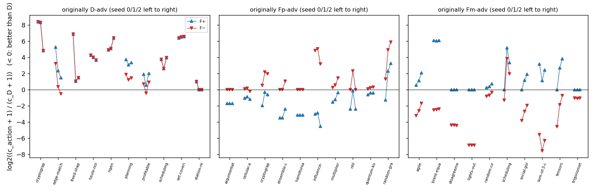
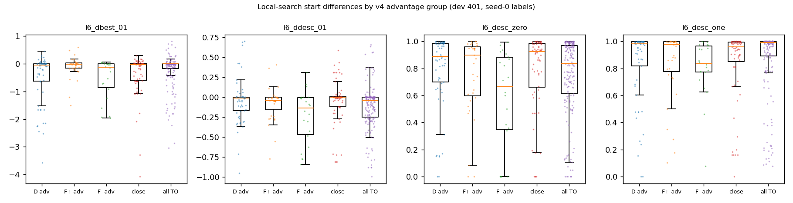
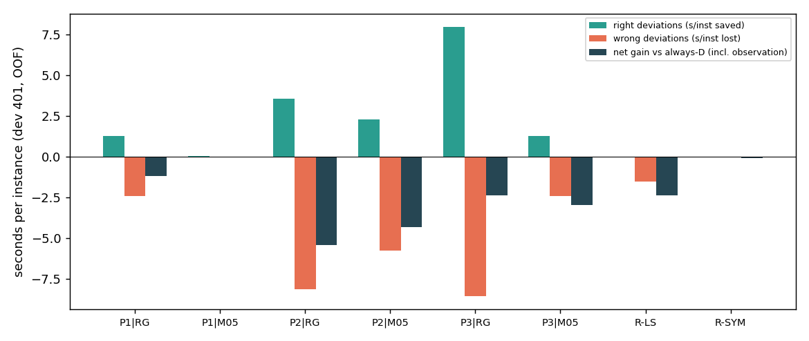
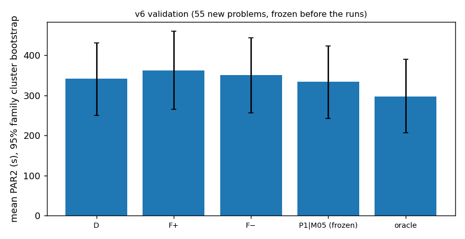

# Goal v6 最终报告：稳定的 forcephase 优势子群能否被低成本、可复现的观察识别？

日期：2026-10-23（UTC）。分支 `research/forcephase-study`。

- **执行目标**：[Agent Goal v6](../../docs/AGENT_GOAL_STABLE_SELECTION_V6.md)。
- **协议**：[STABLE_SELECTION_PROTOCOL_V6.md](../../docs/STABLE_SELECTION_PROTOCOL_V6.md)，在任何 v6 运行之前提交（`4e1e79e`）；偏离记录见第 7 节，共 3 项。
- **验证前冻结**：提交 `176515a`，标签 `v6-freeze`。

**分报告**：
- [STABILITY.md](STABILITY.md)：R1 稳定性
- [OBSERVATIONS.md](OBSERVATIONS.md)：R2 观测
- [SELECTION.md](SELECTION.md)：R3 选择
- [VALIDATION.md](VALIDATION.md)：R4 验证
- [COMPUTE.md](../../results/stable_selection_v6/COMPUTE.md)：算力账本

## 四个研究问题的回答

**1. 原先的 F+/F− 优势能否在有限 seed 重复中保留？**

能，而且比预想的稳定得多。在 30 题的诊断面板（按赢家平衡，只是诊断）上：
- 原 F+ 优势 8/10、原 F− 优势 9/10 在 seed 0/1/2 下仍是同一动作的稳定优势，合计 85%；原 D 优势为 7/10。
- 原因是 F± 关闭了 rephase，几乎不受 seed 影响：62 对“题 × seed”中搜索逐项相同，CPU 比中位 1.00。会变化的主要是 D 自己。

所以，“标签不稳定”不是 F± 优势题识别不出来的原因。

**2. 修复后的局部搜索或成熟 SAT 特征，是否提供稳定的区分信息？**

两者都已可复现、可测，但区分信息很弱。

- **局部搜索**：改为固定工作量之后，同一输入重复 3 次，所有非计时特征逐项相同；v5 版本有 3/12 题不可复现，已经重现。
  - 组级上有方向一致的差异：F− 优势组从全 1 起点出发的局部搜索明显更难，最终违例数和下降程度都更差。这与“负向决策占优”方向一致，可作为机制假说。
  - 但逐题的秩相关只有约 0.1，配对比较也和随机水平分不开。
- **SATzilla 2024**：官方工具从源码构建，只有 3 个特征组能在 0.5 s 预算内完成；在大公式上只有 64% 能在 3 s 内算完。

**3. 简单规则或“解出概率 + 条件耗时”方法，能否抓住少数有收益的偏离、同时控制错误偏离？**

不能。dev 上的 8 个登记比较都没有正的 OOF 净收益，范围在 −1.42% 到 −0.00% 之间。

- 结果呈两种形态：
  - 偏离多的组合（SATzilla + ridge，偏离 54 次）中，正确偏离省下的时间几乎被错误偏离全部抵消；
  - 保守的组合（M05、R-SYM 规则）几乎从不偏离。
- 同一读出器下，新特征相对 S28 都没有增量；同一输入下，M05 相对 RG 也没有增量。

**4. 在新实例和完整 wrapper 中，收益是否仍然存在？**

没有可靠收益。55 道冻结后的新题上，晋级的负对照策略（S28 + M05，几乎总选 D）为 +2.2% [−0.2, +7.0]：
- 点估计达到了 2% 的实用目标，但区间下界没有大于 0；
- 收益几乎全部来自 2 次正确偏离，都在 dev 家族上；
- 在 v6 开发没用过的家族上为 +0.0%。

F+ 和 F− 作为固定动作也都不优于 D，分别为 −6.1% 和 −2.8%。

**完成路径**：有界负结果（目标第 8 节第 3 条）。

**瓶颈**：不是标签不稳定，也不是观察开销——P1 只要 0.04 s，修复后的局部搜索约 0.1 s。瓶颈是**信号不足与错误偏离的不对称成本**：
- 稳定的 F± 优势题在可负担的观测里只呈现组级、而非逐题的差异；
- 一次错误偏离常常让 D 能解的题超时，损失几百秒，而正确偏离通常只省几十秒；
- 新实例本身也偏大，部分观察无法在上限内完成。

## Summary (English)

Goal v6 asked whether a small, *stable* subgroup of instances that favour F+ or F− can be recognised by cheap, reproducible observations and exploited with a single flag choice at full cost.

1. **The advantages are stable, but the selectors still fail.** On a winner-balanced 30-instance diagnostic panel, 17 of 20 original F+/F− advantages held over solver seeds 0/1/2. Forcephase disables rephasing, so F± searches are essentially seed-independent; only D varies. Label noise is therefore not what prevents identification.
2. **The new observations are reproducible but only weakly informative.**
   - The local-search observation was rebuilt with fixed flip budgets and became fully reproducible; the v5 non-reproducibility was reproduced first.
   - It shows a group-level pattern: for F−-favoured instances, local search from the all-ones start is harder.
   - Its per-instance correlations are only about 0.1.
   - Only three groups of the official SATzilla 2024 extractor fit the observation budget.
3. **None of the eight registered comparisons improves on always-D in dev cross-validation** (−1.42% to −0.00%). The comparisons combine three inputs with a ridge gate or a solve-probability-plus-conditional-time model, plus two depth-2 rules. Neither the new features nor the probability/time reader adds anything measurable.
4. **No reliable gain on fresh instances.** On 55 fresh instances run after the freeze, the promoted negative-control strategy scored +2.2% [−0.2, +7.0]. The gain comes from two correct deviations in families seen in development; on families not used in development it was +0.0%.

The outcome is a bounded negative result. The limiting factors are weak per-instance signal and the asymmetric cost of wrong deviations, which often turn a solvable instance into a timeout.

## 核心图









## 结论分类

| 类别 | 内容 |
| --- | --- |
| **已知旧结果** | v4/v5：D 是最好的固定动作；v5 的 27 个组合都不优于 D；v5 的局部搜索观测不可复现。 |
| **新实测** | F± 优势在 3 个 seed 下 85% 稳定（30 题诊断面板）。修复后的局部搜索与 obsprofile6 逐项可复现。SATzilla 子集的成本与覆盖。8 个比较都不优于 D，也都没有增量。真实 wrapper 与离线评分 30/30 一致。55 道新题上 +2.2% [−0.2, +7.0]。 |
| **相关性（描述性）** | F− 优势组的局部搜索：全 1 起点的最少违例数更高，下降更少，两个端点起点的终点更不一致。逐题相关约 0.1。 |
| **机制假说** | F− 占优的实例中，“全 0”附近的赋值区域比“全 1”附近更容易接近满足。F± 对 seed 不敏感的原因是 rephase 被关闭。 |
| **未实施** | SATzilla 的 base、structure、ncnf-graphs、dia、lp、lobjois、sp 组，因为超出观察预算，ls 与 cl 则需要调用预编译求解器；R3 晋级候选在 dev 401 上的全量真实 wrapper（按目标只做了 30 题检查）；多于 3 个 seed 的稳定性检验。 |

## 局限

- **R1 面板**：按赢家挑选、只有 30 题和 3 个 seed，稳定比例不能推广到总体。
- **验证集**：
  - 55 题中 46 题是大公式，因为剩余的未曝光题几乎都是大公式；
  - 28 题属于 dev 家族，没有从未曝光的家族；
  - 区间很宽：平均 PAR2 约 341 s，单题最多可改变约 3 个百分点（600/55 ≈ 10.9 s）。
- **验证的对象**：验证的是一个几乎从不偏离的负对照策略，而不是一个真正有偏离能力的选择器。这是预先固定的晋级规则的结果，因为 dev 上没有正的候选。

## 复现

**最小复现命令**（2026-10-23 在 gs-srun 容器中实际执行，输出保存在 `$FP_DATA/v6_smoke/repro/output.txt`）：

```bash
cd /mnt/home/zhaofeng/workspace/online-tuning-forcephase && mkdir -p /mnt/data/zhaofeng/projects/workspace/online-tuning-forcephase/v6_smoke/repro && source /mnt/data/shared/config/env.sh && GENESIS_IMAGE_VER=1_26 gs-srun --partition=cpu-low --nodes=1 --ntasks=1 --cpus-per-task=4 --time=00:20:00 bash -c 'cd /mnt/home/zhaofeng/workspace/online-tuning-forcephase && H=474e9594ec7885cb1bebf66073eb2de2 && xz -dc /mnt/data/zhaofeng/projects/workspace/online-tuning-forcephase/benchmarks/cnf/$H.cnf.xz > /tmp/v6repro.cnf && for r in 1 2; do build/tools/obsprofile6 --sections=s28,resid,ls --cap=3 --ls-flips=50000 /tmp/v6repro.cnf > /tmp/v6o$r.json; done && python3 -c "import json; a,b=(json.load(open(f\"/tmp/v6o{r}.json\")) for r in (1,2)); print(\"ls\", a[\"sections\"][\"ls\"][\"status\"], \"identical non-timing features:\", a[\"features\"]==b[\"features\"], {k:a[\"features\"][k] for k in (\"l6_dbest_01\",\"l6_desc_zero\",\"l6_desc_one\")})" && rm -rf /tmp/v6w && python3 scripts/stable_selection_v6/v6_wrapper.py --strategy configs/stable_selection_v6/frozen/P1_M05_final.json --cnf /tmp/v6repro.cnf --timeout 300 --workdir /tmp/v6w && python3 -c "import json; r=json.load(open(\"/tmp/v6w/result.json\")); print(\"path\", r[\"path\"], \"action\", r[\"action\"], \"gains\", {k: round(v,1) for k,v in r[\"gains\"].items()}, \"exit\", r[\"answer_exit\"], \"observation+wrapper cpu\", round(r[\"overhead_cpu\"],3), \"formal cpu\", round(r[\"formal\"][\"cpu\"],2))"' 2>&1 | grep -v "^Genesis\|^srun" | tee /mnt/data/zhaofeng/projects/workspace/online-tuning-forcephase/v6_smoke/repro/output.txt
```

输出（`output.txt` 原文）：

```
ls ok identical non-timing features: True {'l6_dbest_01': -0.226396, 'l6_desc_zero': 0.974395, 'l6_desc_one': 0.978472}
path reader action D gains {'Fp': -70.5, 'Fm': -37.0} exit 10 observation+wrapper cpu 0.029 formal cpu 4.13
```

**流水线**：
1. R0 面板：`python3 scripts/stable_selection_v6/make_panels.py`
2. R1 运行：`scripts/slurm_submit.sh configs/stable_selection_v6/v6_seed1.json,configs/stable_selection_v6/v6_seed2.json 2 48 cpu-low 03:00:00`
3. R1 分析：`$FP_PY scripts/stable_selection_v6/r1_stability.py`
4. R2 工具构建（容器内）：`BUILD_SATZILLA=1 scripts/stable_selection_v6/build_tools.sh`
5. R2 工程运行：`scripts/stable_selection_v6/slurm_v6run.sh 1 48 01:00:00 -- obs6|obs5ls|sz ...`
6. R2 分析：`r2_engineering.py`、`r2_observations.py`
7. R3：`$FP_PY scripts/stable_selection_v6/v6select.py --export`
8. R3 真实检查与 R4 运行：`scripts/stable_selection_v6/slurm_v6run.sh 1 30 01:30:00 -- wrap --hashes configs/stable_selection_v6/check30.txt --strategy-map configs/stable_selection_v6/frozen/strategy_map_dev.json`，以及 `scripts/stable_selection_v6/slurm_validate.sh 2 03:00:00 configs/stable_selection_v6/frozen/P1_M05_final.json`
9. 评估：`$FP_PY scripts/stable_selection_v6/v6_evaluate.py --validate`
10. 账本：`python3 scripts/stable_selection_v6/compute_ledger.py`

## 算力

v6 共用 22.37 CPU 核时（上限 60），累计 144.65 核时（上限 200）。

| 阶段 | 实际（核时） | 上限 |
| --- | ---: | ---: |
| R0/R1 | 7.3 | 16 |
| R2/R3（含估计的分析） | 约 2.2 | 8 |
| dev 真实检查 | 1.3 | 6 |
| 新实例验证 | 11.6 | 28 |

所有解出都通过独立检查，运行器错误 0 个。
