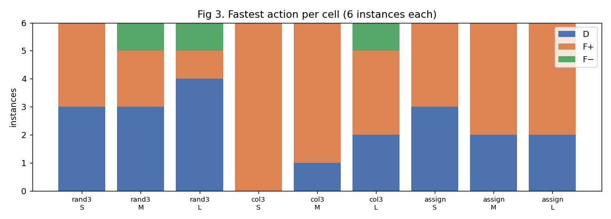

# v8 S1：三种固定模式在受控新题上的完整时间

日期：2026-10-24（UTC）。协议：[STRATIFIED_PROTOCOL_V8.md](../../docs/STRATIFIED_PROTOCOL_V8.md)。逐格数字表：[BASELINES_TABLES.md](BASELINES_TABLES.md)。逐题数据：[per_instance.csv](../../results/stratified_v8/per_instance.csv)。

## 面板与完成状态

- **规模**：54 道基础题，3 类型 × 3 档规模 × 每格 6 题，每格 4 道开发、2 道留出，按生成身份哈希分割。尺度由试采样确定：

  | 类型 | S | M | L |
  |---|---|---|---|
  | rand3（n） | 260 | 300 | 350 |
  | col3（n） | 400 | 500 | 550 |
  | assign（T） | 400 | 500 | 600 |

- **完成情况**：54 × {D, F+, F−} = 162 次正式运行全部完成并独立验证通过，没有任何截止或删题。所以三种模式在开发集、留出集和全部 54 题上的完整平均都可计算。
- **曝光顺序**：开发题在 S1 运行。留出题在规则冻结（`v8-rule-freeze`）之后才在 S3 运行，并与 wrapper 交错。下面的“全部 54 题”在冻结之后才汇总。

| 集合 | D 平均 | F+ 平均 | F− 平均 | oracle 平均 | 开发集选出的 SBS |
|---|---:|---:|---:|---:|---|
| 开发 36 题 | 13.53 s | 10.24 s（+24.3%） | 8.93 s（+34.0%） | 6.81 s（+49.6%） | F− |
| 留出 18 题 | 5.55 s | 9.41 s（−69.4%） | 24.44 s（−340.2%） | 3.73 s（+32.9%） | （F−） |
| 全部 54 题（描述性） | 10.87 s | 9.96 s（+8.4%） | 14.10 s（−29.7%） | 5.78 s（+46.8%） | — |

百分比为相对 D 的收益，即 1 − 均值 / D 均值。oracle 是事后逐题取最快者，不含观察成本，不可部署。

## 主要规律

1. **随机 3-SAT（阈值附近，正负号均匀）：赢家由真实答案决定，结构上看不出。**
   - UNSAT 共 7 题，全部是 F+ 或 F− 更快。中位 log2(F+/D) = −0.77，log2(F−/D) = −0.59，约快 1.3–2 倍。总量 D 475 s，F+ 281 s，F− 252 s。
   - SAT 共 11 题，10 题是 D 最快。F± 中位慢 4–6 倍，最坏一题 F− 慢 600 倍（0.5 s 对 309 s）。
   - 规模越大，两边的绝对得失都越大：L 档 UNSAT 上 D 约 190–226 s、F± 约 100–140 s；SAT 上 D 只要 0.5–1.5 s。
   - 开发集的两道 L 档 UNSAT 题让 F− 成为开发集的 SBS；留出集的两道 L 档恰好都是 SAT，同一选择变成大亏。
2. **图 3 着色：F+ 最稳，F− 常常更差。**
   - F+ 在 18 题中 14 题最快：UNSAT 6/6，SAT 8/12。但优势不大，中位 log2(F+/D)：SAT −0.89，UNSAT −0.30。
   - F− 在 SAT 题上中位慢 1.27 倍，最坏慢 37 倍。
   - 全假起点只违反每个顶点的“至少一色”子句（违反权重最少；a04_viol_w_lr ≈ −4.3），却并不更好。所以“违反最少”的直觉方向与实际赢家相反。
3. **耦合任务分配（在预注册结构下极易）：D ≈ F+，F− 约慢 1.9 倍。**
   - 全部 18 题为 SAT，0.1–0.8 s 内完成。D 与 F+ 之差的中位数为 0.03 s，最大 0.16 s，按“明确优势”阈值几乎都算接近。
   - F− 稳定更慢（中位 log2(F−/D) = +0.89）。全假起点不满足每个任务的“恰一”中的至少一项，而顺序计数器的辅助变量方向也随之不利。
4. **收益高度集中**：oracle 相对 D 在全部 54 题上共省 274.6 s，其中最大的 1 题占 45.6%，前 3 题占 83.5%：两道 rand3 L 档 UNSAT 题和一道 col3 M 档 UNSAT 题，都在开发集。
5. **几乎没有“预处理直接解出”**：54 题中 D 运行冲突数为 0 的有 0 题。assign 虽然很快，但都进入了搜索（几百个冲突）。

## 明确优势与接近

明确优势的阈值为 max(0.25 s, 5% × 第二快)。5% 来自试采样的 D 重复：相对差的中位数为 0.3%，乘 3 后低于下限 5%。按此阈值：

- rand3 的赢家几乎都是明确优势；
- col3 有一半左右是接近；
- assign 几乎全是接近，因为差异小于 0.25 s。

逐格计数见 [BASELINES_TABLES.md](BASELINES_TABLES.md)。

## 可利用空间是否足以覆盖观察成本（S2 跳过规则）

开发集上 SBS（F−）比 oracle 多 76.0 s，观察成本合计 2.7 s（实测 obsprofile6 CPU + 每题 0.05 s），所以按规则开展选择器研究。但这 76 s 的大部分来自 rand3 的 SAT/UNSAT 差异，而静态观察区分不了 SAT 和 UNSAT，见 [FEATURES_AND_RULES.md](FEATURES_AND_RULES.md)。
