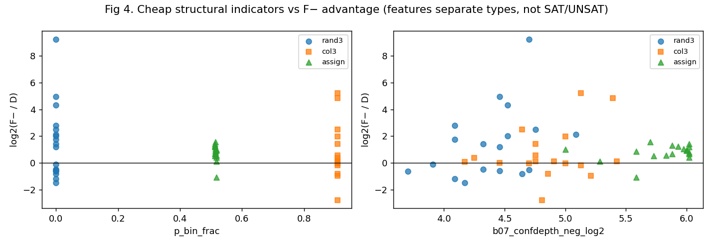

# v8 S2：优势题的特点与两种小方法

日期：2026-10-24（UTC）。只用 36 道开发题，规则冻结之前没有任何留出数据。协议第 7 节；结果文件：[s2_models.json](../../results/stratified_v8/s2_models.json)；冻结策略：[strategy.json](../../configs/stratified_v8/frozen/strategy.json)。

## 观察与 11 个指标

- **工具**：v6 的 `obsprofile6`，sections s28、polar、resid、bilat，总上限 2 s。
- **完成率**：开发集 36/36 完成，合计 0.93 CPU 秒；部署 wrapper 的实测开销为每题 0.035–0.135 s（含 Python 启动）。
- **指标**：
  - 规模（只用规模的对照组）：p_log_vars、p_log_clauses、p_cv_ratio；
  - 方向与结构：a01_wpos_frac、p_bin_frac、p_allpos_cls_frac、p_allneg_cls_frac、a04_viol_w_lr、b03_props_lr_mean、b07_confdepth_pos_log2、b07_confdepth_neg_log2。

**三类题在指标上完全分开，各取 54 题的均值：**

| 指标 | rand3 | col3 | assign |
|---|---:|---:|---:|
| p_cv_ratio（子句/变量） | 4.26 | 3.63 | 2.01 |
| p_bin_frac | 0.00 | 0.91 | 0.52 |
| a01_wpos_frac（加权正文字比例） | 0.50 | 0.07 | 0.42 |
| a04_viol_w_lr（全假与全真违反权重的对数比） | 0.00 | −4.31 | −4.36 |
| b03_props_lr_mean（正负决策传播量对数比） | 0.00 | 3.35 | 3.50 |
| b07_confdepth_neg_log2 / pos_log2 | 4.39 / 4.35 | 4.85 / 4.08 | 5.81 / 4.15 |

**但在 rand3 内部，指标分不开 SAT 和 UNSAT。** 11 道 SAT 与 7 道 UNSAT 在方向和结构指标上的均值差都远小于组内标准差，例如：

| 指标 | SAT 均值 ± 标准差 | UNSAT 均值 ± 标准差 |
|---|---|---|
| a04_viol_w_lr | 0.017 ± 0.154 | −0.013 ± 0.058 |
| b07_confdepth_neg_log2 | 4.47 ± 0.29 | 4.26 ± 0.35 |
| a01_wpos_frac | 0.497 ± 0.008 | 0.500 ± 0.005 |

均匀随机 3-SAT 的符号对称，廉价的方向指标在期望上为 0，与 SAT/UNSAT 无关。而 rand3 里 F± 是快 2 倍还是慢几百倍，恰恰由 SAT/UNSAT 决定。

## 两种小方法（嵌套分组交叉验证，目标为总 CPU 加观察成本）

- **折数**：N = 54 时每格只有 4 道开发题。按“格内排名 mod K”，实际为外层 4 折、内层 3 折，每折每格 1 题（协议第 9 节说明 3）。

| 读出器 | 指标 | 外层 CV 总量（含观察） | 偏离 D 次数 | 各折选出的超参数 |
|---|---|---:|---:|---|
| 始终 D | — | 487.0 s | 0 | — |
| SBS = 始终 F−（样本内选出） | — | 321.3 s | 36 | — |
| T：深度 ≤ 2 规则树 | 全部 11 | 398.1 s | 22 | θ_T = 10 / 10 / 2 / 10 |
| **R：岭回归 t_a − t_D** | 全部 11 | **291.8 s** | 16 | (α, θ) = (10, 5) / (100, 5) / (1, 1) / (10, 0) |
| T_s：规则树 | 只用规模 3 个 | 292.6 s | 26 | θ_T = 2 / 2 / 0 / 0 |
| R_s：岭回归 | 只用规模 3 个 | 513.1 s | 12 | (10, 5) / (10, 5) / (100, 20) / (100, 20) |
| oracle（不可部署） | — | 245.3 s | — | — |

- **读法**：
  - **新增观测的增量不一致**：同一读出器下，岭回归加入方向与结构指标后从 513.1 降到 291.8，规则树却从 292.6 升到 398.1（指标多了，树在 27 道训练题上过拟合）。最好的“只用规模”读出器（T_s）与最好的完整读出器（R）几乎一样。所以没有证据表明方向与结构指标比“认出题型”更有用。
  - **R 在交叉验证中学到的，本质上是按题型分路**：rand3 → F−（12 题中 11 题），col3 → D 或 F+，assign → D。它在开发集上胜过 SBS（291.8 对 321.3，−9.2%），全部来自 col3 与 assign 不再用 F−；rand3 部分与 SBS 相同。
  - rand3 的 SAT/UNSAT 差异是 oracle 空间的主体，两种方法都抓不到。
- **冻结**：按规则冻结 R。在全部开发题上，内层选出 α = 10、θ_R = 5 s，样本内总量 288.8 s。
  - 冻结后在开发集上的决策：rand3 12/12 → F−，col3 12/12 → D，assign 11/12 → D、1/12 → F+。
  - 实机 decide-only 检查：36/36 与离线一致。

## 结构信号与规模信号

- 规模指标本身就足以区分三类题，因为三类的子句/变量比与大小完全不同。所以“规模 vs 结构”的对照在这里实际上是“题型识别 vs 题型识别加方向指标”。
- 在同一类型内部，规模只改变得失的幅度，不改变由 SAT/UNSAT 决定的方向。
- 局部搜索起点差异（目标中的可选项）没有采集。原因：rand3 的方向信号在期望上为 0，col3 与 assign 的赢家已由题型决定；而预算主要留给验证与机制检查。
