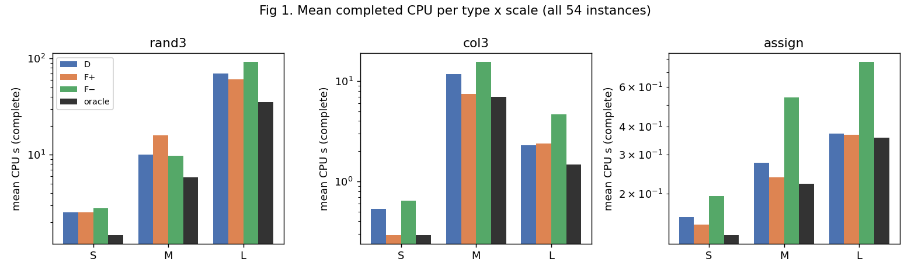
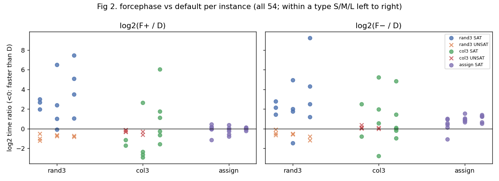
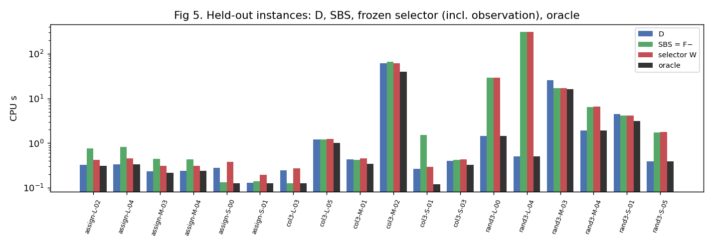

# Goal v8 最终报告：受控类型、规模与难度上的 D / F+ / F−

日期：2026-10-24（UTC）。分支 `research/forcephase-study`。

- **执行目标**：[Agent Goal v8](../../docs/AGENT_GOAL.md)。
- **协议**：[STRATIFIED_PROTOCOL_V8.md](../../docs/STRATIFIED_PROTOCOL_V8.md)，在任何试采样之前提交（`b9dd488`）。偏离 2 项、说明 1 项、登记 1 项，见协议第 9、10 节。
- **冻结**：
  - 面板：`f213347`，标签 `v8-panel-freeze`；
  - 规则：`5450003`，标签 `v8-rule-freeze`，在任何留出运行之前。
- **分报告**：
  - [BASELINES.md](BASELINES.md)：三种固定模式；
  - [FEATURES_AND_RULES.md](FEATURES_AND_RULES.md)：指标与两种小方法；
  - [VALIDATION.md](VALIDATION.md)：留出验证；
  - [MECHANISM.md](MECHANISM.md)：符号翻转与换号检查；
  - [COMPUTE.md](../../results/stratified_v8/COMPUTE.md)：算力账本。

## 结论（只就这三类生成题、这块 54 题面板）

**1. 哪种 flag 更合适，取决于题型，以及题型内部的真实答案；规模主要放大得失。**

- **阈值随机 3-SAT**：
  - UNSAT 上 F+ / F− 7 题全胜，约快 1.3–2 倍；
  - SAT 上 D 11 题中赢 10 题，F± 中位慢 4–6 倍，最坏慢约 600 倍；
  - n 越大，两边的绝对秒数都越大。
- **图 3 着色**：F+ 最稳，18 题中 14 题最快，但优势不大；F− 常常比 D 差。
- **耦合任务分配**（在预注册结构下极易，0.1–0.8 s）：D ≈ F+，F− 约慢 1.9 倍。
- **全部 54 题的完整平均**（描述性，非冻结比较）：

  | 方法 | 平均 CPU | 相对 D |
  |---|---:|---:|
  | D | 10.87 s | — |
  | F+ | 9.96 s | +8.4% |
  | F− | 14.10 s | −29.7% |
  | oracle | 5.78 s | +46.8% |

  oracle 的节省高度集中：前 3 题占 83.5%。

**2. 哪些差异是机制，哪些是偶然？**

- **F+ 与 F− 的不对称是极性效应**：所有文字取反后两者几乎对调，配对误差中位 9–15%。这包括着色与分配编码上“F− 更差”。
- **随机 3-SAT 的 UNSAT 优势是 forcephase 关闭 rephase 本身带来的**：换号、翻转后都保持 5/5，幅度不变。
- **着色 SAT 题与分配题上逐题“谁略快”很大程度是编号偶然**：只换号就有约一半题换边。

**3. 低成本观察能否在留出新题上带来净收益？在这里不能。**

- **观察能做到什么**：11 个廉价静态指标能认出题型，开销每题 0.03–0.13 s；但它们分不开随机 3-SAT 的 SAT 与 UNSAT，而这恰恰决定了 F± 是赚 2 倍还是亏几百倍。
- **开发集上**：嵌套交叉验证中，岭回归选择器比开发集的 SBS（始终 F−）好 9.2%，按规则冻结。只用规模的规则树几乎一样好，所以方向与结构指标没有一致的增量。
- **留出 18 题的真实求解**（全部完成、全部验证）：

  | 方法 | 平均 CPU | 相对 D |
  |---|---:|---:|
  | D | 5.55 s | — |
  | SBS（F−） | 24.44 s | −340% |
  | 冻结选择器 | 24.13 s | −334%（相对 SBS +1.3%） |
  | oracle | 3.73 s | +33% |

  原因是留出集的两道大随机题恰好都是 SAT，选择器按开发集经验给随机题选 F−。6 次偏离中 4 次错误，一题就多花 309 s。
- **结论**：选择器没有胜过 D，也基本没有胜过 SBS，不能说明在线识别有增益。开发集与留出集上 SBS 的方向完全相反（+34% 对 −340%），说明在这样的面板规模和重尾下，固定 flag 的优劣本身就不稳定。
- 对 0.1–0.3 s 的极快题，观察开销占 30–50%，应直接用 D。







## 局限

- **面板很小**：每个类型 × 规模格只有 4 道开发、2 道留出，留出结论对 SAT/UNSAT 抽样极其敏感。只有 3 个生成类型，不能推广到其他家族，也不能代表比赛题分布；本轮没有回答旧 v7 面板上的问题。
- **耦合分配题太容易**：按预注册的结构参数（4 个资源、每任务 3 个可选、冲突度 5.6、容量余量 4%），即使取到网格上限 T = 600，也只要 0.2–0.8 s。这一类实际上只起“极快题 / 观察开销”对照的作用，没有改结构去调难度。
- **偏离 2 改变了正式题数**：最终尺度遇到“目标夹在两个已测点之间”时，改为插值而不是越过已测点外推。按原实现，N 会是 27；按偏离，N 为 54。这一改动只看成本、不看赢家，协议第 9 节有记录。
- **测量误差不是主要问题**：试采样中 D 重复运行的相对差中位 0.3%；同批次 wrapper 正式求解与同动作固定运行之差中位 0.011 s。真正的变动来自题与题之间（包括换号造成的约 1.5–2 倍）。
- **研究者自由度**：选择器只冻结了一个；两种方法、超参数网格、折法与冻结规则都在试采样前写定。

## 复现

本轮实际执行过的命令（留出评价，输出 `primary_comparison_complete: true`）：

```bash
python3 scripts/completion_v7/evaluate.py --config configs/stratified_v8/eval_holdout.json \
  --runs results/stratified_v8/normalized_holdout.json --out results/stratified_v8/summary_holdout.json
```

完整流水线：

1. `scripts/stratified_v8/slurm_run.sh <stage> <budget> <plan>`，依次为 pilot_r1、pilot_r2、s1_dev、s3_holdout、mech_dev；
2. `normalize.py` → `features.py` → `models.py` → `report.py --holdout` → `figures.py`。

运行器在 `$FP_DATA/runs/stratified_v8/<stage>/` 已有记录时会跳过；要重跑，用新的 stage 名。实例按 [formal_manifest.json](../../results/stratified_v8/formal_manifest.json) 中的命令与 seed 可逐字节重生成（SHA-256 校验）。

## 算力

v8 合计 1.850 核时：

| 项 | 核时 |
|---|---:|
| 试采样 | 0.387 |
| S1 | 0.335 |
| S3 | 0.321 |
| 机制检查 | 0.729 |
| 生成、环境、分析（含估计上限） | 0.078 |

（以上均含检查器。）累计 195.89 + 1.85 = **197.74 / 200**。旧 v7 的 55 题面板与其 null 结果原样保留。
