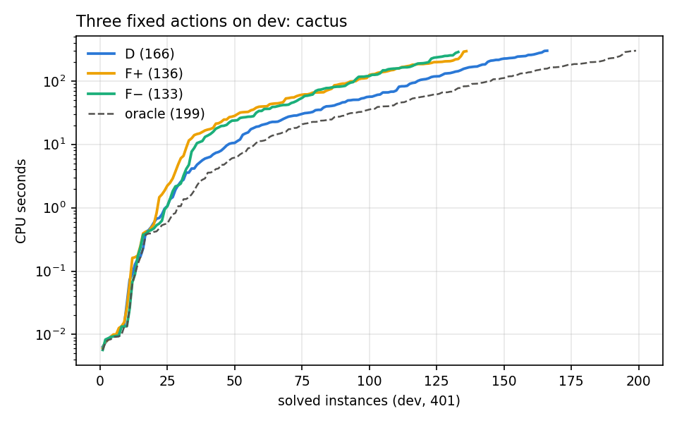
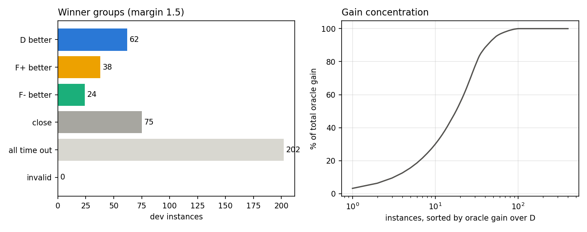
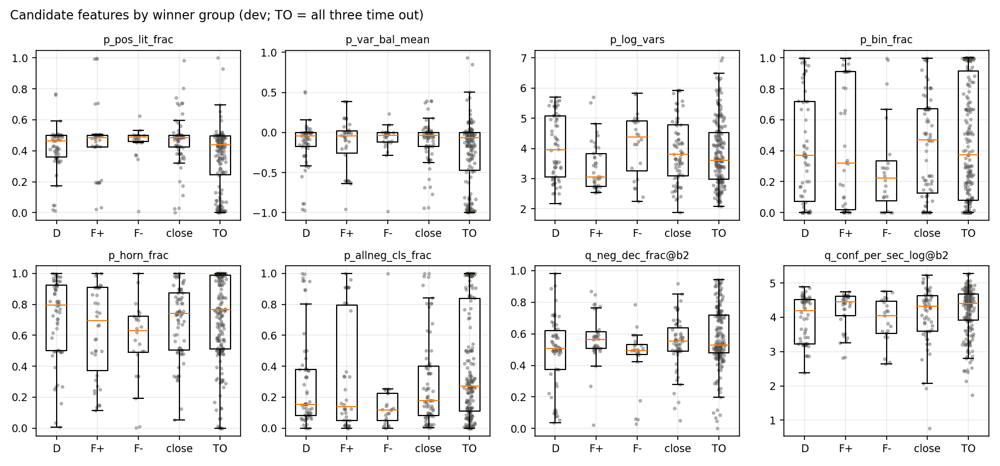

# S1：dev 面板上三种固定动作的逐题对照与优势组特点

由 `scripts/three_way/baseline_profile.py` 生成；只读 dev（train + val，401 个实例）记录。规则见 [THREE_WAY_PROTOCOL.md](../../docs/THREE_WAY_PROTOCOL.md) 第 5–7 节；逐题数据见 `results/three_way/winner_profiles.csv` 与 `dev_fixed.csv`。cost = 解出时的 CPU 秒，否则 PAR2 = 600。

## 1. 运行与验证

- 1203 次运行（401 实例 × 3 动作）：复用第一轮 1032 次，本轮新跑 171 次。
- 状态：D solved 166, timeout 235；F+ solved 136, timeout 265；F− solved 133, timeout 268
- 每个 solved 都经过独立检查（SAT：checkmodel；UNSAT：lrat-trim）。

## 2. 三动作总体对照（S1a）

| 动作 | solved | SAT | UNSAT | mean PAR2 | train PAR2 | val PAR2 |
|---|---:|---:|---:|---:|---:|---:|
| D | 166 | 94 | 72 | 382.1 | 382.7 | 380.2 |
| F+ | 136 | 64 | 72 | 422.0 | 427.0 | 406.9 |
| F− | 133 | 61 | 72 | 425.1 | 428.1 | 416.1 |
| hindsight oracle（不可部署） | 199 | | | 336.2 | 336.2 | 336.4 |

- dev 上 mean PAR2 最低的固定动作：**D**（候选的“最佳固定动作”，第 8 节正式确定）。
- oracle 相对 D 的总增益 18387 秒（每题平均 45.9 秒，12.0%）；有正增益的实例 163 个，前 10 个占 30%，前 25 个占 67%。

两两比较（x-only = 只有 x 解出；faster = 两者都解出且 (c_y+1)/(c_x+1) ≥ 1.5）：

| x vs y | x-only | y-only | x faster | y faster | 都解出且接近 | 都未解出 |
|---|---:|---:|---:|---:|---:|---:|
| D vs F+ | 53 | 23 | 31 | 27 | 55 | 212 |
| D vs F− | 48 | 15 | 31 | 18 | 69 | 220 |
| F+ vs F− | 30 | 27 | 24 | 22 | 60 | 238 |

## 3. 优势分组（S1b，margin 阈值 1.5；敏感性 1.2 / 2.0）

| 组 | 实例（m=1.5） | 其中 exclusive | 其中 faster | m=1.2 | m=2.0 | train | val | 组内 PAR2 收益（相对D，秒） |
|---|---:|---:|---:|---:|---:|---:|---:|---:|
| D 优势 | 62 | 36 | 26 | 68 | 49 | 45 | 17 | 0 |
| F+ 优势 | 38 | 18 | 20 | 48 | 29 | 25 | 13 | 9138 |
| F− 优势 | 24 | 10 | 14 | 31 | 20 | 21 | 3 | 6361 |
| 差距很小 | 75 | 0 | 0 | 52 | 101 | 60 | 15 | 2888 |
| 三者都超时 | 202 | 0 | 0 | 202 | 202 | 150 | 52 | 0 |
| 无可靠结果 | 0 | 0 | 0 | 0 | 0 | 0 | 0 | 0 |

“差距很小”组的近优集合：D|F+|F− 39，D|F− 16，D|F+ 10，F+|F− 10

按配额年与事后结果（observed：任一动作解出时的答案）：

| 组 | 2022 | 2023 | 2024 | 2025 | 2026 | SAT | UNSAT | unknown |
|---|---:|---:|---:|---:|---:|---:|---:|---:|
| D 优势 | 8 | 23 | 14 | 13 | 4 | 49 | 13 | 0 |
| F+ 优势 | 6 | 6 | 13 | 8 | 5 | 24 | 14 | 0 |
| F− 优势 | 5 | 6 | 5 | 3 | 5 | 22 | 2 | 0 |
| 差距很小 | 11 | 17 | 14 | 18 | 15 | 22 | 53 | 0 |
| 三者都超时 | 25 | 40 | 42 | 39 | 56 | 0 | 0 | 202 |
| 无可靠结果 | 0 | 0 | 0 | 0 | 0 | 0 | 0 | 0 |

### 家族集中度

每个优势组中实例最多的家族（括号内为该家族 dev 实例总数）：

- D 优势（62，来自 34 个家族）：scheduling 6（20），school-timetabling 5（8），planning 4（7），set-covering 4（9），cryptography-cbmc 3（3），cryptography 3（13），grs-fp-comm 3（6），edge-matching 3（3）
- F+ 优势（38，来自 20 个家族）：hamiltonian 6（9），quantum-kochen-specker 3（3），argumentation 3（12），multiplier 3（7），disagreement-parity 2（9），cellular-automata 2（5），ensemble-computation 2（3），random-graph-xorsat 2（4）
- F− 优势（24，来自 20 个家族）：brent-equations 3（4），random-csp 2（3），cryptography-ascon 2（5），cellular-automata 1（5），crafted-cec 1（5），random-modularity 1（2），multiplier 1（7），agile 1（1）

家族级别（dev 实例 ≥ 5 的家族；PAR2 秒，cost 最低者加粗）：

| 家族组 | n | D | F+ | F− | D/F+/F− 优势 | close | 都超时 |
|---|---:|---:|---:|---:|---|---:|---:|
| scheduling | 20 | **447** | 552 | 540 | 6/0/1 | 1 | 12 |
| coloring | 15 | **600** | 600 | 600 | 0/0/0 | 0 | 15 |
| cryptography | 13 | **413** | 482 | 507 | 3/2/0 | 1 | 7 |
| miter | 12 | 259 | **231** | 257 | 0/1/0 | 7 | 4 |
| argumentation | 12 | **350** | 395 | 480 | 2/3/0 | 2 | 5 |
| disagreement-parity | 9 | 600 | **499** | 536 | 0/2/1 | 0 | 6 |
| tseitin-formulas | 9 | 600 | 558 | **552** | 0/0/0 | 1 | 8 |
| hamiltonian | 9 | 264 | **128** | 373 | 1/6/1 | 0 | 1 |
| set-covering | 9 | **35** | 278 | 284 | 4/2/0 | 3 | 0 |
| school-timetabling | 8 | **277** | 600 | 600 | 5/0/0 | 0 | 3 |
| planning | 7 | **132** | 204 | 223 | 4/0/0 | 2 | 1 |
| pigeon-hole | 7 | 600 | **556** | 600 | 0/1/0 | 0 | 6 |
| multiplier | 7 | 351 | **222** | 349 | 0/3/1 | 1 | 2 |
| cryptography-simon | 6 | **300** | 300 | 300 | 0/0/0 | 3 | 3 |
| grs-fp-comm | 6 | **335** | 360 | 442 | 3/0/0 | 0 | 3 |
| sudoku | 6 | 315 | 600 | **305** | 0/0/0 | 4 | 2 |
| cellular-automata | 5 | 161 | 270 | **88** | 1/2/1 | 1 | 0 |
| bitvector | 5 | **600** | 600 | 600 | 0/0/0 | 0 | 5 |
| crafted-cec | 5 | 100 | **98** | 159 | 1/0/1 | 3 | 0 |
| belpyramid-puzzle | 5 | **249** | 256 | 256 | 2/0/0 | 1 | 2 |
| mutilated-chessboard | 5 | **367** | 395 | 386 | 1/0/0 | 1 | 3 |
| social-golfer | 5 | 600 | 600 | **488** | 0/0/1 | 0 | 4 |
| cryptography-ascon | 5 | 385 | 361 | **170** | 0/0/2 | 3 | 0 |

## 4. 可观察特点：特征与相对 D 的代价比

响应量（199 个非“都超时 / 无可靠结果”实例）：r_F+ = log2((c_F+ + 1)/(c_D + 1))，r_F− 同理；负值表示比 D 快。ρ 为 Spearman；CI 为按家族组的 cluster bootstrap（400 次）；ρ_fam 为家族内中心化后的秩相关；train/val 为两个 split 分别计算的 ρ。标签：**稳定** = CI 不含 0，且家族内、train、val 三个 ρ 都与整体同号、绝对值都 ≥ 0.1；**相关** = CI 不含 0，但不满足其余条件；**未确认** = CI 含 0。

### r_F+：|ρ| 最大的 14 个特征

| 特征 | 类 | ρ [CI] | ρ_fam | ρ train / val | 标签 |
|---|---|---|---:|---|---|
| q_cp_stable_frac@2s | 试跑 | 0.30 [0.15, 0.42] | -0.02 | 0.33 / 0.24 | 相关 |
| q_elim_frac@0.1s | 试跑 | 0.29 [-0.22, 0.65] | -0.14 | 0.49 / — | 未确认 |
| q_dec_per_conf@2s | 试跑 | 0.28 [0.03, 0.44] | 0.17 | 0.37 / 0.02 | 相关 |
| q_chrono_frac@2s | 试跑 | 0.27 [0.04, 0.45] | 0.05 | 0.39 / -0.15 | 相关 |
| q_chrono_frac@0.5s | 试跑 | 0.25 [0.01, 0.42] | 0.04 | 0.36 / -0.06 | 相关 |
| q_cp_stable_frac@0.1s | 试跑 | 0.23 [-0.16, 0.45] | -0.11 | 0.34 / -0.40 | 未确认 |
| p_log_clauses | 静态 | 0.22 [0.04, 0.37] | 0.17 | 0.25 / 0.11 | 稳定 |
| q_dec_per_conf@0.5s | 试跑 | 0.22 [-0.04, 0.38] | 0.08 | 0.30 / -0.03 | 未确认 |
| p_log_vars | 静态 | 0.22 [0.03, 0.37] | 0.27 | 0.23 / 0.18 | 稳定 |
| q_cp_glue_mean@0.1s | 试跑 | 0.22 [-0.09, 0.49] | 0.36 | 0.17 / 0.37 | 未确认 |
| q_cp_glue_mean@2s | 试跑 | 0.21 [-0.02, 0.40] | 0.34 | 0.25 / -0.01 | 未确认 |
| q_chrono_frac@0.1s | 试跑 | 0.21 [-0.07, 0.43] | -0.02 | 0.28 / 0.07 | 未确认 |
| p_var_pureneg_frac | 静态 | 0.21 [0.00, 0.36] | 0.12 | 0.20 / 0.24 | 稳定 |
| q_props_per_dec_log@0.5s | 试跑 | -0.20 [-0.34, -0.05] | -0.10 | -0.22 / -0.21 | 相关 |

### r_F−：|ρ| 最大的 14 个特征

| 特征 | 类 | ρ [CI] | ρ_fam | ρ train / val | 标签 |
|---|---|---|---:|---|---|
| q_elim_frac@0.1s | 试跑 | 0.39 [0.00, 0.64] | 0.02 | 0.40 / — | 相关 |
| q_cp_stable_frac@2s | 试跑 | 0.23 [0.00, 0.40] | 0.20 | 0.32 / -0.07 | 相关 |
| q_cp_glue_mean@0.1s | 试跑 | 0.22 [-0.04, 0.48] | 0.36 | 0.23 / 0.36 | 未确认 |
| q_chrono_frac@0.5s | 试跑 | 0.22 [0.00, 0.39] | 0.14 | 0.23 / 0.12 | 稳定 |
| p_horn_frac | 静态 | 0.22 [0.05, 0.35] | 0.11 | 0.23 / 0.13 | 稳定 |
| q_chrono_frac@0.1s | 试跑 | 0.22 [-0.00, 0.40] | 0.04 | 0.20 / 0.28 | 未确认 |
| q_cp_target_neg_frac@0.5s | 试跑 | 0.20 [-0.01, 0.37] | 0.27 | 0.24 / 0.26 | 未确认 |
| q_restarts_per_kconf@0.5s | 试跑 | 0.19 [-0.03, 0.36] | 0.02 | 0.19 / 0.15 | 未确认 |
| p_antihorn_frac | 静态 | -0.18 [-0.33, -0.03] | -0.23 | -0.25 / 0.07 | 相关 |
| p_pos_lit_frac | 静态 | -0.17 [-0.31, -0.02] | -0.20 | -0.23 / -0.01 | 相关 |
| q_cp_saved_neg_frac@0.5s | 试跑 | 0.17 [-0.05, 0.35] | 0.15 | 0.20 / 0.21 | 未确认 |
| p_binpos_frac | 静态 | -0.16 [-0.32, 0.01] | 0.02 | -0.18 / -0.05 | 未确认 |
| q_fixed_frac@0.5s | 试跑 | -0.16 [-0.41, 0.06] | -0.23 | -0.14 / -0.27 | 未确认 |
| q_fixed_frac@0.1s | 试跑 | -0.16 [-0.42, 0.04] | -0.33 | -0.01 / -0.48 | 未确认 |

### r_F+ − r_F−：|ρ| 最大的 14 个特征

| 特征 | 类 | ρ [CI] | ρ_fam | ρ train / val | 标签 |
|---|---|---|---:|---|---|
| q_cp_trail_frac@0.5s | 试跑 | -0.22 [-0.38, -0.03] | 0.10 | -0.18 / -0.40 | 相关 |
| q_neg_dec_frac@0.5s | 试跑 | -0.21 [-0.39, -0.03] | -0.25 | -0.23 / -0.15 | 稳定 |
| q_native_pos_frac@0.5s | 试跑 | 0.21 [0.03, 0.39] | 0.25 | 0.23 / 0.15 | 稳定 |
| q_cp_saved_neg_frac@0.5s | 试跑 | -0.20 [-0.42, 0.02] | -0.06 | -0.20 / -0.19 | 未确认 |
| q_cp_target_neg_frac@0.5s | 试跑 | -0.20 [-0.40, 0.02] | -0.08 | -0.19 / -0.23 | 未确认 |
| p_binpos_frac | 静态 | 0.19 [-0.03, 0.38] | 0.16 | 0.19 / 0.04 | 未确认 |
| q_neg_dec_frac@2s | 试跑 | -0.19 [-0.36, -0.03] | -0.20 | -0.18 / -0.18 | 稳定 |
| q_native_pos_frac@2s | 试跑 | 0.19 [0.03, 0.36] | 0.20 | 0.18 / 0.18 | 稳定 |
| p_log_vars | 静态 | 0.18 [0.00, 0.35] | 0.19 | 0.28 / -0.13 | 相关 |
| q_dec_per_conf@2s | 试跑 | 0.18 [0.01, 0.34] | -0.03 | 0.27 / -0.14 | 相关 |
| q_elim_frac@0.1s | 试跑 | -0.17 [-0.74, 0.34] | 0.60 | 0.16 / — | 未确认 |
| q_chrono_frac@2s | 试跑 | 0.16 [-0.00, 0.31] | -0.01 | 0.26 / -0.16 | 未确认 |
| q_cp_stable_frac@0.1s | 试跑 | 0.16 [-0.13, 0.38] | -0.07 | 0.20 / -0.35 | 未确认 |
| p_log_clauses | 静态 | 0.15 [-0.03, 0.32] | 0.13 | 0.26 / -0.27 | 未确认 |

标签计数（全部特征 × 3 个响应量）：试跑-未确认 192，试跑-相关 10，试跑-稳定 5，静态-未确认 77，静态-相关 3，静态-稳定 4

### 极性假说（“正文字多 → F+，负文字多 → F−”）

- p_pos_lit_frac 与 r_F+ − r_F−：ρ = 0.09 [-0.09, 0.28]，家族内 0.02，train/val 0.14/0.02 → 未确认
- p_var_bal_mean 与 r_F+ − r_F−：ρ = 0.03 [-0.20, 0.23]，家族内 0.01，train/val 0.05/0.03 → 未确认
- p_allneg_cls_frac 与 r_F+ − r_F−：ρ = -0.02 [-0.24, 0.17]，家族内 0.05，train/val -0.02/0.08 → 未确认
- p_allpos_cls_frac 与 r_F+ − r_F−：ρ = -0.04 [-0.20, 0.11]，家族内 -0.16，train/val -0.06/0.01 → 未确认
- p_binneg_frac 与 r_F+ − r_F−：ρ = -0.06 [-0.30, 0.17]，家族内 -0.22，train/val -0.11/0.22 → 未确认

### 各组的静态特征中位数 [四分位]

| 特征 | D 优势 | F+ 优势 | F− 优势 | 差距很小 | 三者都超时 |
|---|---|---|---|---|---|
| p_log_vars | 3.96 [3.05, 5.07] | 3.06 [2.74, 3.83] | 4.38 [3.25, 4.91] | 3.81 [3.09, 4.77] | 3.61 [2.97, 4.52] |
| p_cv_ratio | 5.96 [3.64, 10.9] | 9.01 [6.08, 19.1] | 4.35 [4, 15.9] | 4.06 [3.2, 10.5] | 7.03 [3.55, 29.7] |
| p_len_mean | 2.82 [2.64, 3.34] | 3.01 [2.32, 5.23] | 3 [2.76, 3.24] | 2.91 [2.55, 3.69] | 2.71 [2.31, 3.02] |
| p_bin_frac | 0.369 [0.0741, 0.719] | 0.321 [0.0179, 0.911] | 0.222 [0.0769, 0.335] | 0.472 [0.128, 0.672] | 0.373 [0.0795, 0.914] |
| p_pos_lit_frac | 0.463 [0.36, 0.5] | 0.484 [0.426, 0.5] | 0.489 [0.459, 0.5] | 0.485 [0.425, 0.5] | 0.438 [0.245, 0.495] |
| p_horn_frac | 0.797 [0.501, 0.926] | 0.695 [0.372, 0.911] | 0.632 [0.491, 0.723] | 0.74 [0.506, 0.874] | 0.765 [0.511, 0.987] |
| p_antihorn_frac | 0.394 [0.161, 0.515] | 0.389 [0.139, 0.638] | 0.504 [0.343, 0.639] | 0.5 [0.309, 0.717] | 0.453 [0.0212, 0.554] |
| p_allneg_cls_frac | 0.154 [0.0823, 0.379] | 0.14 [0.0487, 0.795] | 0.119 [0.0478, 0.225] | 0.179 [0.0812, 0.401] | 0.272 [0.11, 0.837] |
| p_var_bal_mean | -0.0441 [-0.171, -0.000211] | -0.0393 [-0.259, 0.0189] | -0.0341 [-0.116, 0] | -0.0329 [-0.173, 0.000148] | -0.0635 [-0.471, -0.00102] |
| p_var_absbal_mean | 0.252 [0.0948, 0.406] | 0.325 [0.0869, 0.605] | 0.125 [0.0682, 0.236] | 0.182 [0.0885, 0.375] | 0.239 [0.0554, 0.869] |
| p_occ_cv | 0.806 [0.444, 1.55] | 0.776 [0.292, 1.32] | 0.88 [0.381, 1.5] | 0.817 [0.488, 2] | 0.612 [0.227, 1.32] |

- 试跑 0.1 s：dev 上直接解出 12 个实例（D 的前缀，已验证）；平均试跑 CPU 0.119 s。
- 试跑 0.5 s：dev 上直接解出 19 个实例（D 的前缀，已验证）；平均试跑 CPU 0.505 s。
- 试跑 2 s：dev 上直接解出 28 个实例（D 的前缀，已验证）；平均试跑 CPU 1.919 s。

各组的 2 s 试跑统计中位数：

| 特征 | D 优势 | F+ 优势 | F− 优势 | 差距很小 | 三者都超时 |
|---|---|---|---|---|---|
| q_log_conflicts | 4.42 | 4.75 | 4.35 | 4.51 | 4.71 |
| q_conf_per_sec_log | 4.2 | 4.45 | 4.05 | 4.32 | 4.41 |
| q_neg_dec_frac | 0.506 | 0.565 | 0.495 | 0.551 | 0.528 |
| q_saved_src_frac | 0.831 | 0.769 | 0.873 | 0.795 | 0.769 |
| q_cp_saved_neg_frac | 0.536 | 0.781 | 0.611 | 0.628 | 0.613 |
| q_fixed_frac | 0.0237 | 0.0698 | 0.0624 | 0.0853 | 0.0382 |
| q_learned_len | 37.8 | 33.5 | 31.5 | 26.4 | 42.4 |

## 5. 图

