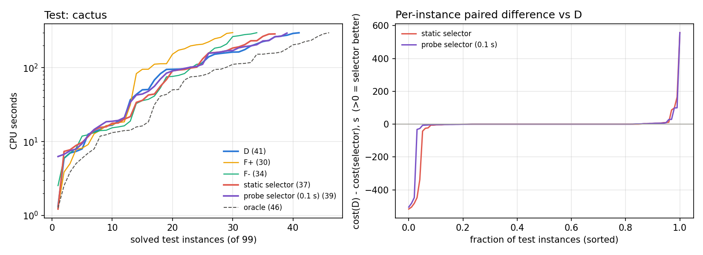

# S3：冻结策略在 test 上的真实结果

由 `scripts/three_way/evaluate_test.py` 生成。冻结点：tag `tw-freeze`（提交 b9b7a87），在任何 test 运行之前。test = 99 个实例（31 个家族组，与 dev 家族不相交）。cost：解出且验证通过为总 CPU 秒，否则 600；wrapper 的 cost 是整个进程树的实测总 CPU（特征 + 试跑 + 推理 + 正式求解）。

## 1. 运行完整性

| 策略 | solved | timeout |
|---|---:|---:|
| D | 41 | 58 |
| F+ | 30 | 69 |
| F− | 34 | 65 |
| 静态选择器 | 37 | 62 |
| 试跑选择器（0.1 s） | 39 | 60 |

- 固定动作 297 次运行中 60 次复用第一轮记录（这些实例在冻结前未被读取），其余为本轮新跑。
- 所有 solved 都经过独立检查：SAT 用 checkmodel 对照原始 CNF，UNSAT 用 lrat-trim。

## 2. 主结果

| 策略 | solved | SAT | UNSAT | mean PAR2 | 相对 D（PAR2 降低，95% 家族 cluster bootstrap CI） |
|---|---:|---:|---:|---:|---|
| D | 41 | 23 | 18 | 397.6 | — |
| F+ | 30 | 16 | 14 | 450.7 | -13.4% [-20.0, -7.0]（-53.1 s/题） |
| F− | 34 | 17 | 17 | 425.7 | -7.1% [-16.5, +2.1]（-28.1 s/题） |
| 静态选择器 | 37 | 22 | 15 | 412.2 | -3.7% [-10.4, +2.5]（-14.6 s/题） |
| 试跑选择器（0.1 s） | 39 | 22 | 17 | 404.4 | -1.7% [-7.9, +3.2]（-6.8 s/题） |
| hindsight oracle（D/F+/F− 事后最优，不可部署） | 46 | | | 363.7 | +8.5% |

最佳固定动作（dev 上选定）= D，所以“相对最佳固定动作”与“相对 D”是同一个比较。正值表示比 D 好。

## 3. 选择器细节

### 静态选择器

- 选择：D 51，F− 29，F+ 19；决策方式：formal 99。
- 观察开销（正式求解之前的 CPU）：中位 0.195 s，均值 0.490 s，最大 2.062 s；wrapper 总 CPU 减正式求解 CPU：中位 0.267 s。
- 选择本身的质量（把所选动作换成其完整固定运行的 cost，即不计开销）：mean PAR2 409.7（D 397.6）。
- 相对 D 明显更好（cost 低于 D 的 2/3）4 题，明显更差（高于 1.5 倍）8 题；严重回退（协议第 9 节）5 题。
- 相对 oracle 的平均遗憾 48.5 s/题；在至少一个动作解出且由模型作出选择的 46 题中，选中事后最优动作 15 题（准确率 33%，仅作辅助）。

### 试跑选择器（0.1 s）

- 选择：D 51，F− 38，F+ 10；决策方式：formal 99。
- 观察开销（正式求解之前的 CPU）：中位 0.303 s，均值 0.727 s，最大 3.035 s；wrapper 总 CPU 减正式求解 CPU：中位 0.378 s。
- 选择本身的质量（把所选动作换成其完整固定运行的 cost，即不计开销）：mean PAR2 401.5（D 397.6）。
- 相对 D 明显更好（cost 低于 D 的 2/3）2 题，明显更差（高于 1.5 倍）4 题；严重回退（协议第 9 节）3 题。
- 相对 oracle 的平均遗憾 40.7 s/题；在至少一个动作解出且由模型作出选择的 46 题中，选中事后最优动作 22 题（准确率 48%，仅作辅助）。

一致性检查：wrapper 正式求解与同动作固定运行都解出的 76 次中，正式求解 CPU / 固定运行 CPU 的中位数 0.9837（范围 0.826–1.122），两者是同一搜索，差异只来自计时噪声。

## 4. 分层（mean PAR2，括号内为 solved 数）

### 按配额年

| 子集 | n | D | F+ | F− | 静态选择器 | 试跑选择器（0.1 s） | oracle |
|---|---:|---:|---:|---:|---:|---:|---:|
| 2022 | 45 | 445 (15) | 471 (12) | 449 (14) | 468 (12) | 464 (13) | 390 |
| 2023 | 8 | 352 (4) | 374 (4) | 412 (3) | 411 (3) | 411 (3) | 348 |
| 2024 | 12 | 424 (5) | 574 (1) | 488 (3) | 466 (4) | 423 (5) | 417 |
| 2025 | 19 | 275 (12) | 384 (8) | 345 (9) | 245 (13) | 241 (13) | 236 |
| 2026 | 15 | 415 (5) | 417 (5) | 415 (5) | 415 (5) | 415 (5) | 411 |

### 按规模层

| 子集 | n | D | F+ | F− | 静态选择器 | 试跑选择器（0.1 s） | oracle |
|---|---:|---:|---:|---:|---:|---:|---:|
| small | 16 | 492 (4) | 550 (2) | 579 (1) | 522 (3) | 520 (3) | 485 |
| mid | 25 | 334 (13) | 399 (10) | 376 (11) | 368 (11) | 350 (12) | 300 |
| large | 58 | 399 (24) | 446 (18) | 405 (22) | 401 (23) | 396 (24) | 358 |

### 按文件大小

| 子集 | n | D | F+ | F− | 静态选择器 | 试跑选择器（0.1 s） | oracle |
|---|---:|---:|---:|---:|---:|---:|---:|
| ≤100 MB | 50 | 411 (19) | 483 (12) | 459 (14) | 448 (15) | 429 (17) | 380 |
| >100 MB | 49 | 384 (22) | 417 (18) | 392 (20) | 376 (22) | 380 (22) | 347 |

### 按实例曝光（第一轮是否运行过）

| 子集 | n | D | F+ | F− | 静态选择器 | 试跑选择器（0.1 s） | oracle |
|---|---:|---:|---:|---:|---:|---:|---:|
| 第一轮未运行 | 79 | 404 (33) | 442 (26) | 422 (28) | 415 (30) | 412 (31) | 361 |
| 第一轮运行过 | 20 | 374 (8) | 486 (4) | 440 (6) | 401 (7) | 374 (8) | 373 |

### 按家族曝光

| 子集 | n | D | F+ | F− | 静态选择器 | 试跑选择器（0.1 s） | oracle |
|---|---:|---:|---:|---:|---:|---:|---:|
| 家族第一轮未运行 | 44 | 340 (24) | 389 (19) | 340 (22) | 353 (22) | 355 (22) | 274 |
| 家族第一轮运行过 | 55 | 444 (17) | 500 (11) | 494 (12) | 460 (15) | 444 (17) | 435 |

### 按事后结果（任一策略解出时的答案）

| 子集 | n | D | F+ | F− | 静态选择器 | 试跑选择器（0.1 s） | oracle |
|---|---:|---:|---:|---:|---:|---:|---:|
| SAT | 26 | 146 (23) | 267 (16) | 229 (17) | 152 (22) | 155 (22) | 57 |
| UNSAT | 20 | 188 (18) | 293 (14) | 219 (17) | 253 (15) | 210 (17) | 135 |
| unknown | 53 | 600 (0) | 600 (0) | 600 (0) | 600 (0) | 600 (0) | 600 |

### 按家族组（实例 ≥ 3）

| 子集 | n | D | F+ | F− | 静态选择器 | 试跑选择器（0.1 s） | oracle |
|---|---:|---:|---:|---:|---:|---:|---:|
| algorithm-equivalence-checking | 4 | 523 (1) | 495 (1) | 518 (1) | 522 (1) | 516 (1) | 495 |
| baseball-lineup | 3 | 600 (0) | 600 (0) | 600 (0) | 600 (0) | 600 (0) | 600 |
| circuit-equivalence-checking | 7 | 600 (0) | 600 (0) | 600 (0) | 600 (0) | 600 (0) | 600 |
| cril-misc | 3 | 600 (0) | 600 (0) | 600 (0) | 600 (0) | 600 (0) | 600 |
| graph-isomorphism | 5 | 124 (5) | 130 (5) | 62 (5) | 82 (5) | 122 (5) | 51 |
| hardware | 11 | 309 (6) | 359 (5) | 317 (6) | 387 (4) | 312 (6) | 308 |
| independent-set-reconfiguration | 5 | 374 (2) | 484 (1) | 423 (2) | 376 (2) | 375 (2) | 313 |
| maxsat-optimum | 6 | 450 (2) | 519 (1) | 600 (0) | 449 (2) | 445 (2) | 445 |
| md5-equivalence-checking | 3 | 13 (3) | 13 (3) | 13 (3) | 14 (3) | 15 (3) | 13 |
| oddball-weighing | 3 | 415 (1) | 437 (1) | 461 (1) | 415 (1) | 415 (1) | 415 |
| polynomial-multiplication | 4 | 453 (1) | 600 (0) | 459 (1) | 459 (1) | 453 (1) | 453 |
| sat-x | 4 | 600 (0) | 600 (0) | 460 (1) | 461 (1) | 461 (1) | 460 |
| software-verification | 11 | 395 (6) | 487 (3) | 421 (5) | 392 (6) | 384 (6) | 333 |
| tree-decomposition | 4 | 507 (1) | 600 (0) | 600 (0) | 508 (1) | 508 (1) | 507 |
| （其余小家族） | 26 | 347 (13) | 416 (10) | 409 (9) | 399 (10) | 399 (10) | 297 |

## 5. 图

